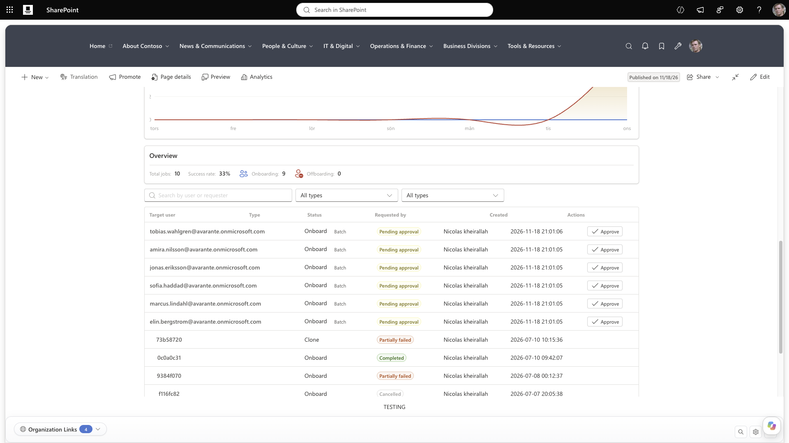
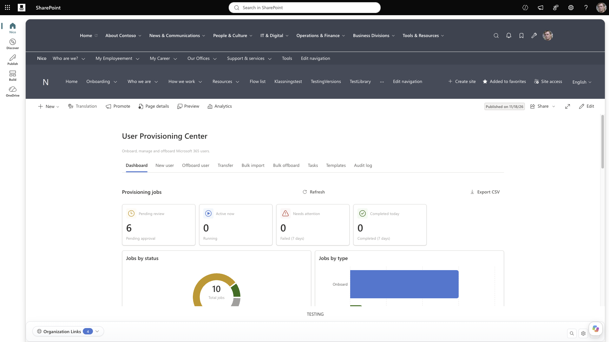
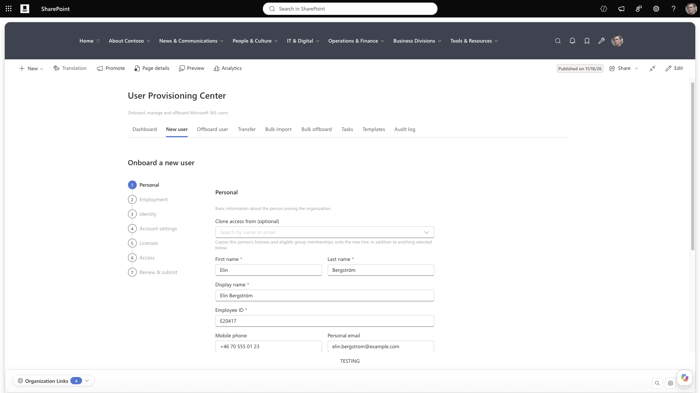
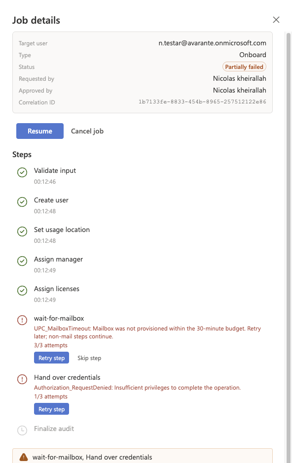
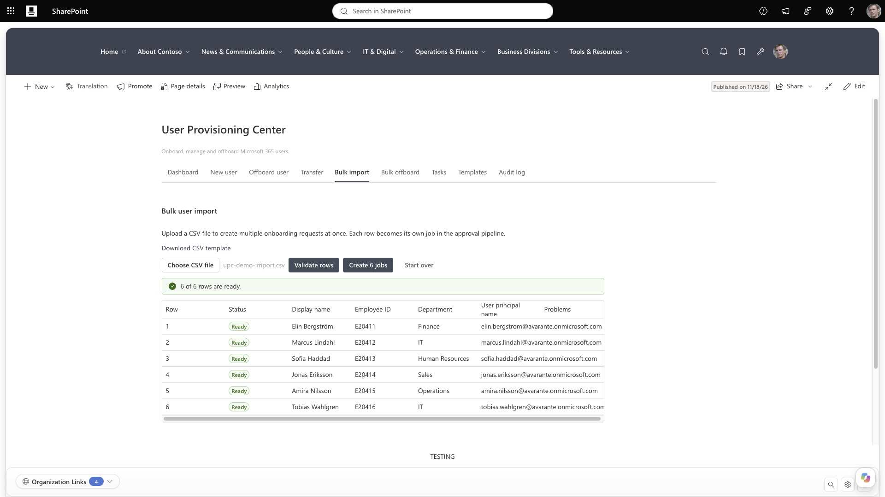
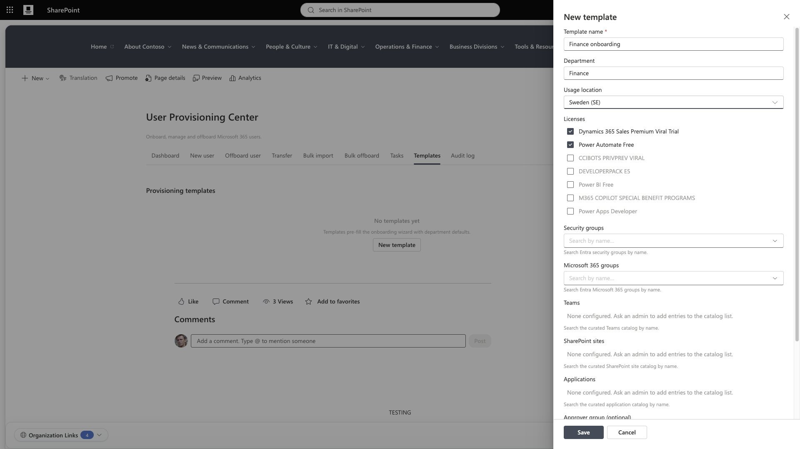

# User Provisioning Center

## Summary

User Provisioning Center runs employee onboarding, transfers and offboarding from inside Microsoft 365, with no Azure Functions and no custom backend. Every operation is a delegated Microsoft Graph call made from the browser under the signed-in operator's own permissions. Job state, tasks, templates and the audit trail are stored in SharePoint lists (`UPC_*`) that the solution creates for you. When Graph cannot do something from a client context (for example disabling a hybrid-synced on-premises account), the job creates a service-desk task instead of failing silently.

The same code runs as a SharePoint web part, a Microsoft Teams tab and a Teams personal app.

It uses SPFx 1.24.1 with the Heft toolchain, React 18.3.1, Fluent UI v9, PnPJS v4, TanStack Query, React Hook Form and Yup.

The dashboard job grid with search, filters and inline **Approve**:



The dashboard hosted on a SharePoint page, with KPI tiles and charts:



The first step of the onboarding wizard, with the optional clone-access picker:



The job detail drawer, with per-step progress and an inline retry on a failed step:



The bulk import after row validation, before any jobs are created:



The department template editor:



## Compatibility

| :warning: Important          |
|:---------------------------|
| Every SPFx version is optimally compatible with specific versions of Node.js. In order to be able to build this sample, you need to ensure that the version of Node on your workstation matches one of the versions listed in this section. This sample will not work on a different version of Node.|
|Refer to <https://aka.ms/spfx-matrix> for more information on SPFx compatibility.   |

This sample is optimally compatible with the following environment configuration:


-Incompatible-red.svg "SharePoint Server 2016 Feature Pack 2 requires SPFx 1.1")


### Fluent UI v9 and SharePoint page chrome

SharePoint's own page chrome already bundles Fluent UI v9. When this web part loads its own copy, both bundles generate the same `fui-FluentProviderX` class names, and portal-rendered surfaces (dialogs, drawers, toasts, dropdown lists) appear unstyled. The app avoids this by wrapping everything in `IdPrefixProvider` with a per-instance prefix in [src/components/App.tsx](./src/components/App.tsx). Do not remove it, and check popups on a real SharePoint page after any UI change.

## Applies to

* [SharePoint Framework](https://learn.microsoft.com/sharepoint/dev/spfx/sharepoint-framework-overview)
* [Microsoft 365 tenant](https://learn.microsoft.com/sharepoint/dev/spfx/set-up-your-development-environment)
* [Microsoft Teams](https://learn.microsoft.com/sharepoint/dev/spfx/build-for-teams) (tab and personal app)

> Get your own free development tenant by subscribing to [Microsoft 365 developer program](https://aka.ms/m365/devprogram)

## Contributors

* [Nicolas Kheirallah](https://github.com/NicolasKheirallah)

## Version history

|Version|Date|Comments|
|-------|----|--------|
|1.0|November 18, 2026|Initial release|

## Prerequisites

* Node.js 22.14.0 or later in the 22.x line, 24 or 26 (see `engines` in `package.json`). `.nvmrc` pins the version used for the PnP build, which is Node.js 22. The solution also builds on Node.js 24 and 26.
* A tenant admin who can approve API permission requests in the SharePoint admin center. The solution requests eight delegated Microsoft Graph permissions, declared in [config/package-solution.json](./config/package-solution.json):
  * `User.ReadWrite.All`
  * `GroupMember.ReadWrite.All`
  * `Organization.Read.All`
  * `Directory.Read.All`
  * `UserAuthenticationMethod.ReadWrite.All`
  * `Mail.Send`
  * `User.Invite.All`
  * `TeamMember.ReadWrite.All`
* An app catalog (tenant-wide or site collection) to upload the package to.
* Owner rights on the site that will hold the `UPC_*` lists, so the web part can create them from its property pane.
* Microsoft Entra security groups to map onto the six app roles: ITAdmin, HRAdmin, DepartmentManager, ServiceDesk, Auditor and ReadOnly. The app roles only control what the UI shows (see [Security model](#security-model)).
* Entra directory roles for the operators who run jobs. The delegated Graph permissions only take effect up to what the signed-in operator is allowed to do, so each operator needs the role behind every action they run. A Global Administrator can do all of it. The web part checks the signed-in operator's roles and shows a preflight bar when one is missing.

  | Action | Entra role that allows it |
  |---|---|
  | Create and update users, revoke sign-in sessions | User Administrator |
  | Assign and remove licenses | License Administrator or User Administrator |
  | Manage group membership | Groups Administrator, or ownership of the target groups |
  | Manage Teams membership | Teams Administrator, or ownership of the target teams |
  | Create Temporary Access Passes | Authentication Administrator or Privileged Authentication Administrator |
  | Invite guests | Guest Inviter or User Administrator |

The Graph permissions are granted at tenant level only after the package has been uploaded to the app catalog. Deploy the package once and approve the requests (**SharePoint admin center > Advanced > API access**) before you test in the hosted workbench or on a page.

## Minimal path to awesome

* Clone this repository (or [download this solution as a .ZIP file](https://pnp.github.io/download-partial/?url=https://github.com/pnp/sp-dev-fx-webparts/tree/main/samples/react-user-provisioning-center) then unzip it)
* From your command line, change your current directory to the directory containing this sample (`react-user-provisioning-center`, located under `samples`)
* In the command line run:
  * `npm install`
  * `npm run start`
* Open the hosted workbench at `https://<your-tenant>.sharepoint.com/_layouts/workbench.aspx` and add the **User Provisioning Center** web part.
* Edit the web part and select **Provision UPC lists** in the property pane to create and seed the `UPC_*` lists. Then follow [Set up roles and data](#set-up-roles-and-data).

To produce the package for your app catalog, run `npm run build`. The package is written to `sharepoint/solution/user-provisioning-center.sppkg`.

> This sample can also be opened with [VS Code Remote Development](https://code.visualstudio.com/docs/remote/remote-overview). Visit <https://aka.ms/spfx-devcontainer> for further instructions.

The local workbench is not supported. The web part calls `msGraphClientFactory`, which the local workbench cannot back with a real token, and the Fluent UI v9 collision described above does not reproduce there either.

## Features

This web part illustrates the following concepts on top of the SharePoint Framework:

* Delegated Microsoft Graph calls from a client-side web part with `msGraphClientFactory`, with no backend.
* A client-side job engine that persists each step to a SharePoint list, so a job survives closing the tab and resumes where it stopped.
* Role-based UI driven by Entra group membership (`/me/checkMemberGroups`) and SharePoint list configuration.
* SharePoint list provisioning and seeding from the web part property pane with PnPJS v4.
* One code base for a SharePoint web part, a Teams tab and a Teams personal app, with a SharePoint and Teams theme bridge to Fluent UI v9.
* Hosting a second copy of Fluent UI v9 next to the SharePoint page's own bundle.

### Tabs

Tabs that an operator is not permitted to see are removed, not disabled. If a tab is missing, check the operator's role assignment in `UPC_Roles`.

| Tab | What it does | Needs permission |
|---|---|---|
| Dashboard | KPI tiles that act as filters, search, type filter, an **Only my requests** filter, a sortable job grid with inline **Approve**, CSV export, and a job drawer with live step progress and the actions Run, Resume, Retry, Skip, Cancel, Reject, Rollback and Duplicate. Each job has notes, a per-job audit trail (CSV export) and credential regeneration for completed jobs | everyone |
| New user | Seven-step onboarding wizard (Personal, Employment, Identity, Account settings, Licenses, Access, Review & submit) with template pre-fill, UPN candidates from the naming policy, duplicate employee ID checks, guest invites (through `/invitations` instead of creating a cloud account), access grants (groups, Teams, SharePoint sites, applications), an optional future-dated access review task, and cloning of an existing user's access onto a new hire. Drafts survive tab switches | `createJobs` |
| Offboard user | Four-step wizard: select the user, choose access removal, choose timing (as soon as the job is approved and run, or on a date), review. Blocking sign-in and revoking all sessions is always the first step. Removing licenses and group memberships is optional. The mailbox can be left alone, converted to a shared mailbox or forwarded, and both mailbox actions become service-desk tasks. You can also name a person to get OneDrive access, which creates a hand-over task. For users synced from on-premises Active Directory the sign-in block becomes a manual task, because a Graph write would be reverted by the next sync | `createJobs` |
| Transfer | Single form for an existing user: job title, department, office, manager and license changes. Blank fields mean no change | `createJobs` |
| Bulk import | CSV upload (template available) with per-row validation, directory duplicate checks and UPN resolution. Creates one onboard job per valid row. An optional `template` column applies a named department template | `createJobs` |
| Bulk offboard | CSV of sign-in names, looked up in the directory. Creates one offboard job per resolved row | `createJobs` |
| Bulk transfer | CSV of existing users with the fields to change. Validates manager and SKU part numbers. Creates one transfer job per valid row, sharing a batch ID | `createJobs` |
| Tasks | The service-desk queue for everything the engine routed to `UPC_Tasks`. Completing a task records who and when. CSV export | `manageTasks` |
| Templates | Versioned, activatable department templates: department, usage location, licenses, access grants and an expiration review policy. A template can name an Entra group that alone may approve jobs created from it | `manageTemplates` |
| Catalogs | Editor for the reference lists the wizards read: Teams, SharePoint sites, applications and the license cost table | `manageTemplates` |
| Settings | Approval gate on or off, number of distinct approvers required before a job can run, bulk row limit, dashboard refresh interval and the address notified when a job needs approval | `manageSettings` |
| Roles | Maps each app role to an Entra security group and its permissions. Also holds approval delegations: time-boxed `approveJobs` hand-offs to another operator, with a reason | `manageSettings` (roles), `manageDelegations` (delegations) |
| Audit | Audit trail listing the timestamp, actor, action and Graph endpoint of each recorded call | `viewAudit` |

## Set up roles and data

1. Upload `sharepoint/solution/user-provisioning-center.sppkg` to the app catalog and approve the Graph permission requests in the SharePoint admin center.
2. Add the web part to a page (or add the app to Teams) on the site that will store the data.
3. Edit the web part and select **Provision UPC lists** in the property pane. Provisioning is idempotent: it creates missing lists, columns and indexes and leaves existing ones alone. It also seeds one `UPC_Settings` row (`Title='app'`) with the default settings and one `UPC_Roles` row for each of the six roles with its default permission set filled into `PermissionsJson`. The lists are:
   * `UPC_ProvisioningJobs`
   * `UPC_AuditLog`
   * `UPC_Tasks`
   * `UPC_DepartmentTemplates`
   * `UPC_Settings`
   * `UPC_Roles`
   * `UPC_ApprovalDelegations`
   * `UPC_TeamsCatalog`
   * `UPC_SiteCatalog`
   * `UPC_ApplicationCatalog`
   * `UPC_LicenseCostTable`
4. In `UPC_Roles`, paste the object ID of the matching Entra security group into `MemberGroupId` for each role. The default permission sets are:

   | Role | Default permissions |
   |---|---|
   | ITAdmin | all twelve permissions |
   | HRAdmin | `createJobs`, `approveJobs`, `viewAudit` |
   | DepartmentManager | `createJobs` |
   | ServiceDesk | `createJobs`, `runJobs`, `retrySteps`, `manageTasks` |
   | Auditor | `viewAudit` |
   | ReadOnly | none |

   The full permission set is `createJobs`, `approveJobs`, `runJobs`, `retrySteps`, `skipSteps`, `cancelJobs`, `rollbackJobs`, `manageTemplates`, `viewAudit`, `manageTasks`, `manageSettings` and `manageDelegations`. Role membership is cached for 15 minutes, so reload the page after you change roles.
5. Open the **Catalogs** tab and add the Teams, SharePoint sites and applications the onboarding wizard should offer. Add `UPC_LicenseCostTable` rows (SKU part number and monthly cost) if you want license costs shown in the wizard.

Until `UPC_Roles` has rows, nobody has a role. In that state a site owner is temporarily granted `manageSettings`, `manageDelegations` and `viewAudit` so they can finish the setup.

When you upgrade an existing install, run **Provision UPC lists** again. It adds new columns and choices. Reading jobs keeps working on an old schema, but saving a note or rejecting a job fails until the schema is updated.

## Approval workflow

New jobs start as **Pending approval** until someone with `approveJobs` approves them, either from the dashboard grid or from the job drawer. The approver is recorded in `approvedBy`. Turn the gate off in **Settings** to send jobs straight to ready-to-run.

A department template can name an **approver group**. A job created from that template (wizard, clone or bulk import through the `template` column) can then only be approved by a member of that Entra group, checked against `/me/checkMemberGroups` at approval time. The inline **Approve** button is hidden for these jobs, so they are approved from the job drawer.

An operator with `manageDelegations` can delegate `approveJobs` to a named UPN for a date range, with a reason, from the Roles tab. Delegations have no approval step of their own, so limit who holds `manageDelegations`.

An approver can **reject** a pending job, which requires a reason. The job moves to the terminal **Rejected** status, and the reason is saved as a job note and in the audit trail. Rejection is separate from Cancel: cancel stops a job, reject refuses it with an explanation.

If **Settings > Notify this address when approval is needed** contains a mailbox or distribution list, a mail is sent through `/me/sendMail` when a job enters Pending approval. This is best effort. A failed notification is logged as a warning and never fails the job.

Any job in a terminal state (completed, cancelled, rejected, failed) can be **duplicated** from the drawer. The copy keeps the payload and job type, gets a new correlation ID and a clean step pipeline, and goes through the approval gate again.

A job with `rollbackJobs` can be **rolled back** from the drawer once it is no longer running. Rollback walks the completed steps in reverse and runs each step's compensating action where one exists, for example removing group, Teams and application membership, taking back assigned licenses and clearing the manager. A user account created by the job is disabled, not deleted. Steps that cannot be reversed, such as sent mail or a Temporary Access Pass, are left alone. The job is then marked **Cancelled** and the result per step is written to the audit trail. Rollback does not recreate deleted resources or undo work that a service-desk task already completed by hand.

## Scheduling

Dated jobs are shown but not enforced. A job has a `ScheduledFor` date (set by the **Scheduled** timing option in the offboarding wizard) and the drawer displays it, but the engine only checks the job status, so an operator can still run the job early. Onboarding, transfer and the bulk wizards always save `scheduledFor: null`. Because there is no backend, nothing runs unless an operator has the app open.

## Security model

* Every Graph call runs with the signed-in operator's delegated permissions. What an operator can do is limited by their own Entra directory roles and by the permissions consented for the app.
* App roles and the `UPC_Roles` list decide which tabs and buttons the UI shows. They are not an enforcement boundary, because the browser enforces them. The same applies to the approval gate.
* Temporary passwords and Temporary Access Passes are kept in memory only. They are shown once in a copy-once dialog and are never written to a list or anywhere else.
* The solution writes to production identity systems (Entra ID, Exchange, SharePoint, Teams). Test it in a development tenant first.

## Project layout

```text
/src
  /webparts/provisioningCenter  Web part class, manifest, property pane (list provisioning)
  /components                   App shell and tabs: Jobs, Onboarding, Offboarding, Transfer,
                                Bulk, Tasks, Templates, Catalogs, Settings, Roles, Audit,
                                Preflight, Shared
  /services                     graph, engine (step registry and onboarding, offboarding,
                                transfer steps), sites, namingPolicy, sharePointData, audit,
                                roles, preflight, users, licenses, passwords, provisioning,
                                telemetry, util
  /theme                        SharePoint and Teams to Fluent UI v9 theme bridge
  /hooks /models /validators /contexts /constants
  /loc                          en-US and sv-SE strings
/teams                          Teams app icons
```

### Engine notes

* Job payloads are a discriminated union (`IJobPayload`) with `kind` set to `onboard`, `offboard` or `transfer`. A new job type needs a payload interface and a `stepRegistry.ts` entry. The engine itself does not change.
* Every step is idempotent: it checks state before it writes. Progress is saved to `StepsJson` after each attempt, so a job resumes after the tab is closed.
* SharePoint and Teams themes are bridged to Fluent UI v9 by [src/theme/spThemeToV9.ts](./src/theme/spThemeToV9.ts). SPFx 1.24 still depends on Fluent UI v8 for parts of its own UI (the property pane), so v8 remains in `node_modules` as a transitive dependency. "Fluent UI v9 only" describes this solution's own code.

## Help

We do not support samples, but this community is always willing to help, and we want to improve these samples. We use GitHub to track issues, which makes it easy for  community members to volunteer their time and help resolve issues.

If you're having issues building the solution, please run [spfx doctor](https://pnp.github.io/cli-microsoft365/cmd/spfx/spfx-doctor/) from within the solution folder to diagnose incompatibility issues with your environment.

You can try looking at [issues related to this sample](https://github.com/pnp/sp-dev-fx-webparts/issues?q=label%3A%22sample%3A%20react-user-provisioning-center%22) to see if anybody else is having the same issues.

You can also try looking at [discussions related to this sample](https://github.com/pnp/sp-dev-fx-webparts/discussions?discussions_q=react-user-provisioning-center) and see what the community is saying.

If you encounter any issues using this sample, [create a new issue](https://github.com/pnp/sp-dev-fx-webparts/issues/new?assignees=&labels=Needs%3A+Triage+%3Amag%3A%2Ctype%3Abug-suspected%2Csample%3A%20react-user-provisioning-center&template=bug-report.yml&sample=react-user-provisioning-center&authors=@NicolasKheirallah&title=react-user-provisioning-center%20-%20).

For questions regarding this sample, [create a new question](https://github.com/pnp/sp-dev-fx-webparts/issues/new?assignees=&labels=Needs%3A+Triage+%3Amag%3A%2Ctype%3Aquestion%2Csample%3A%20react-user-provisioning-center&template=question.yml&sample=react-user-provisioning-center&authors=@NicolasKheirallah&title=react-user-provisioning-center%20-%20).

Finally, if you have an idea for improvement, [make a suggestion](https://github.com/pnp/sp-dev-fx-webparts/issues/new?assignees=&labels=Needs%3A+Triage+%3Amag%3A%2Ctype%3Aenhancement%2Csample%3A%20react-user-provisioning-center&template=suggestion.yml&sample=react-user-provisioning-center&authors=@NicolasKheirallah&title=react-user-provisioning-center%20-%20).

## References

* [Build your first SharePoint client-side web part](https://learn.microsoft.com/sharepoint/dev/spfx/web-parts/get-started/build-a-hello-world-web-part)
* [Use Microsoft Graph in your solution](https://learn.microsoft.com/sharepoint/dev/spfx/web-parts/get-started/using-microsoft-graph-apis)
* [Building for Microsoft Teams](https://learn.microsoft.com/sharepoint/dev/spfx/build-for-teams)
* [SharePoint Framework compatibility](https://learn.microsoft.com/sharepoint/dev/spfx/compatibility)
* [PnPJS](https://pnp.github.io/pnpjs/)
* [Heft documentation](https://heft.rushstack.io/)
* [Microsoft 365 Patterns and Practices](https://aka.ms/m365pnp)

## Disclaimer

**THIS CODE IS PROVIDED *AS IS* WITHOUT WARRANTY OF ANY KIND, EITHER EXPRESS OR IMPLIED, INCLUDING ANY IMPLIED WARRANTIES OF FITNESS FOR A PARTICULAR PURPOSE, MERCHANTABILITY, OR NON-INFRINGEMENT.**


