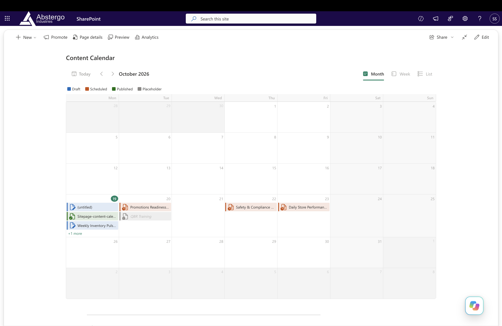
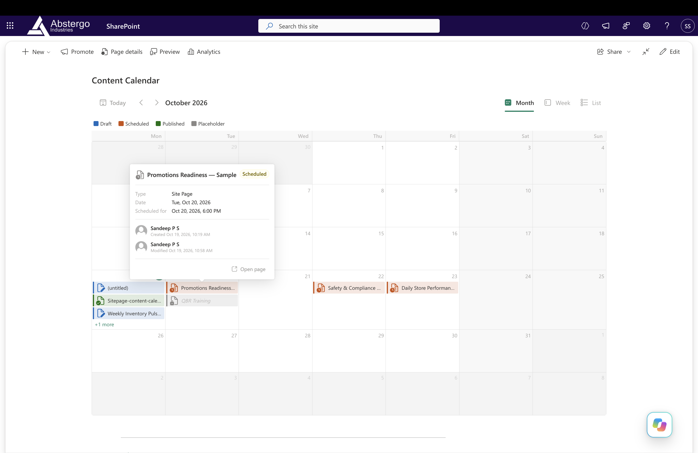
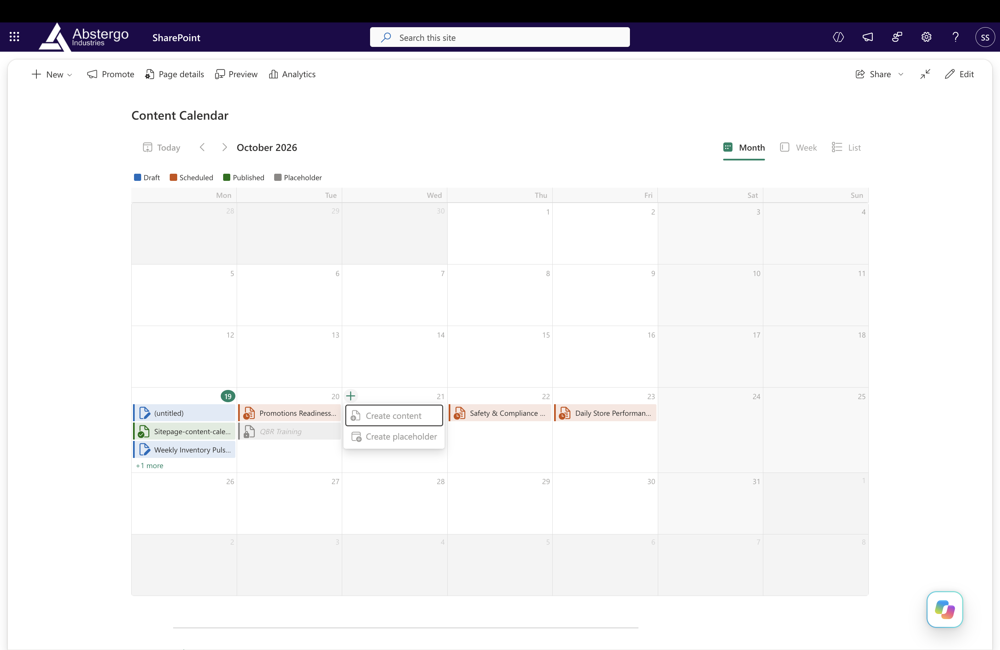
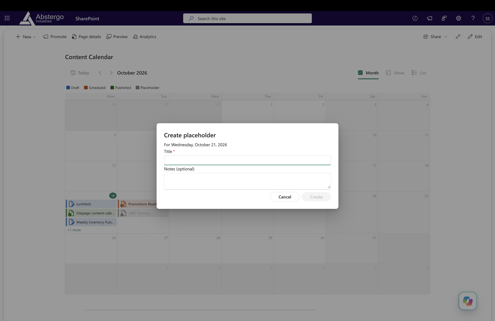
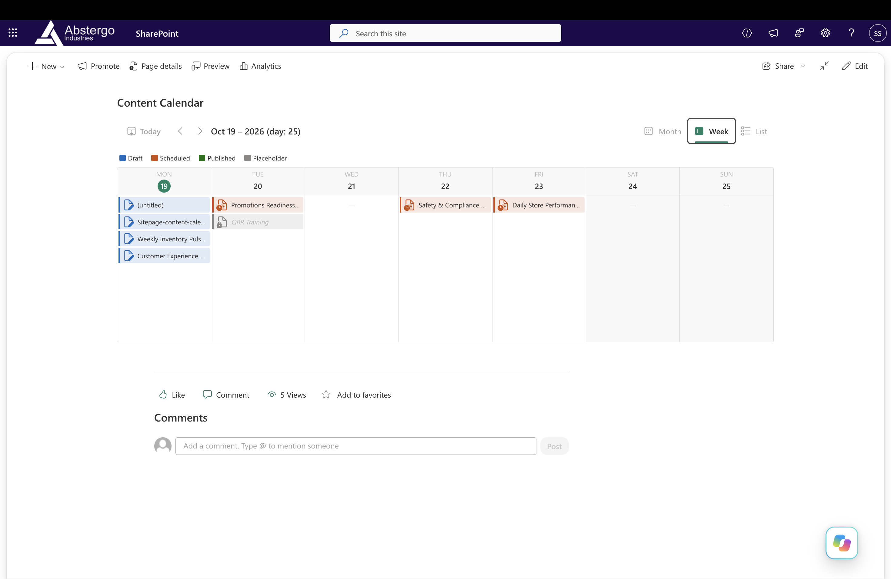
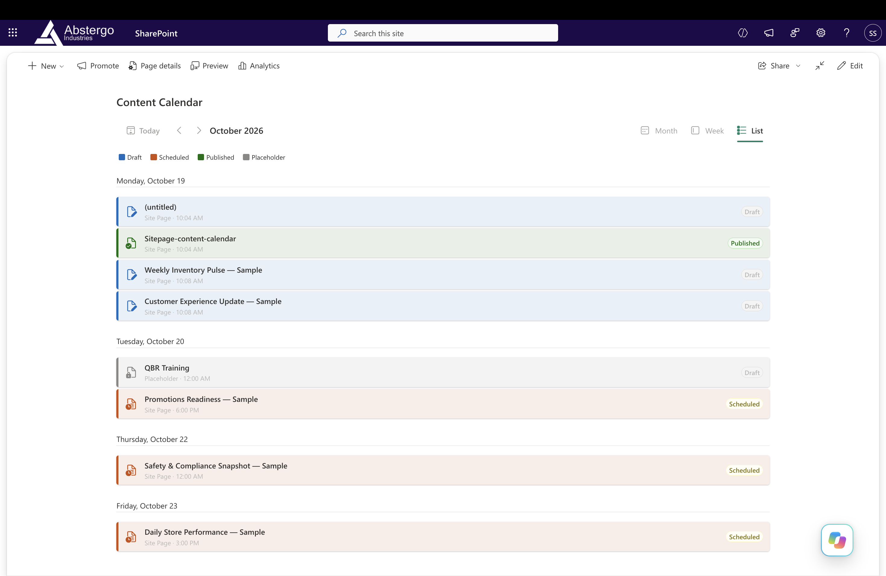

# React Content Calendar

## Summary

The Content Calendar is a SharePoint Framework web part that gives content authors a central place to see and manage their Site Pages schedule. It reads items from a selected site page content type and displays them in month, week, or agenda-style list views. The default field mapping targets the standard `Title`, `Created`, and `ContentType` fields used by a Site Pages library.

Content authors can plan upcoming work by reserving dates with placeholders, then create a modern Site Page directly from the calendar when they are ready. Date navigation, publishing-status filters, and item details make it easier to review the content schedule and keep planned work visible alongside existing pages.

## Used SharePoint Framework Version

## Applies to

- [SharePoint Framework](https://aka.ms/spfx)
- [Microsoft 365 tenant](https://docs.microsoft.com/sharepoint/dev/spfx/set-up-your-developer-tenant)

> Get your own free development tenant by subscribing to [Microsoft 365 developer program](http://aka.ms/o365devprogram)

## Prerequisites

- Node.js `22.14.0` or later in the `22.x` series (the project uses Node.js `22.18.0`).
- A SharePoint site and permission to read the selected content type. The default mapping is designed for the Site Pages library or a compatible list with the expected fields.
- To create pages, permission to add pages to the site's Site Pages library.
- Use the SharePoint hosted workbench to test against live SharePoint content; the web part uses the current SharePoint context.

## Solution

| Solution               | Author(s)                                                     |
| ---------------------- | ------------------------------------------------------------- |
| react-content-calendar | [Sandeep P S](https://github.com/Sandeep-FED)      |

## Version history

| Version | Date | Comments |
| ------- | ---- | -------- |
| 1.0.0   |  19/10/26   | Initial release |

## Minimal Path to Awesome

- Clone this repository.
- Ensure that you are in the solution folder: `samples/react-content-calendar`.
- Use Node.js `22.x`, then run:
  - `npm install`
  - `npm start`

To build and package the solution, run `npm run build`.

## Features

- Month, week, and list views with Today, previous, and next navigation.
- Loads items for the visible date range from the content type. Site Pages scheduled publish dates and moderation status are used when available to determine calendar dates and Draft, Scheduled, or Published status. The service resolves REST property names from library field metadata; future publish dates show as Scheduled on their publish date, even if the page was created outside the visible range. Field-metadata lookup failures are reported instead of silently treating pages as Published.
- Opens item details with content type, publishing status, date, author/editor information, and a link to the page when available.
- Item details show the scheduled publish date and time or the first published date and time (falling back to Created). SharePoint-formatted values from `FieldValuesAsText` preserve the site's date/time formatting; missing text values use locale-formatted raw timestamps. This does not change calendar placement.
- Creates a modern Site Page as a draft and opens it in edit mode. The create dialog can also disable comments on the new page.
- Reserves dates with placeholders, including optional notes. Placeholders are stored in the browser's local storage for that web-part instance; they are not saved to SharePoint.
- Uses Fluent UI 9, PnPjs, and the SharePoint theme.

## Screenshots

### Month view

### Scheduled page details

### Quick-add menu

### Create placeholder

### Week view

### List view

## References

- [Getting started with SharePoint Framework](https://docs.microsoft.com/sharepoint/dev/spfx/set-up-your-developer-tenant)
- [SharePoint Framework documentation](https://learn.microsoft.com/sharepoint/dev/spfx/sharepoint-framework-overview)
- [Heft documentation](https://heft.rushstack.io/)
- [Microsoft 365 Patterns and Practices](https://aka.ms/m365pnp) - Guidance, tooling, samples and open-source controls for Microsoft 365 development.

## Disclaimer

**THIS CODE IS PROVIDED _AS IS_ WITHOUT WARRANTY OF ANY KIND, EITHER EXPRESS OR IMPLIED, INCLUDING ANY IMPLIED WARRANTIES OF FITNESS FOR A PARTICULAR PURPOSE, MERCHANTABILITY, OR NON-INFRINGEMENT.**

