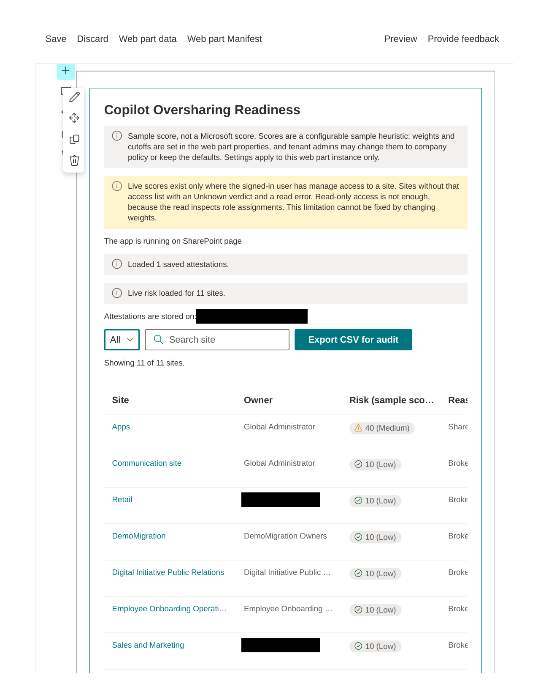
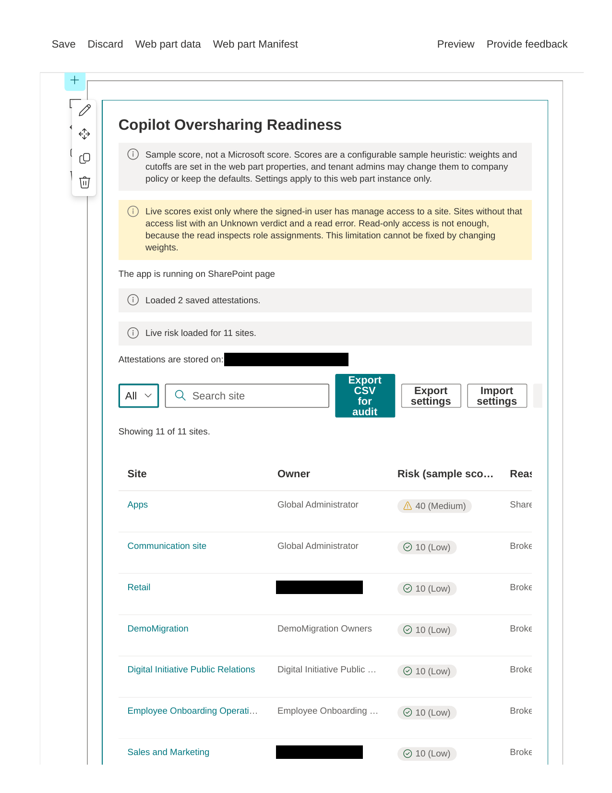
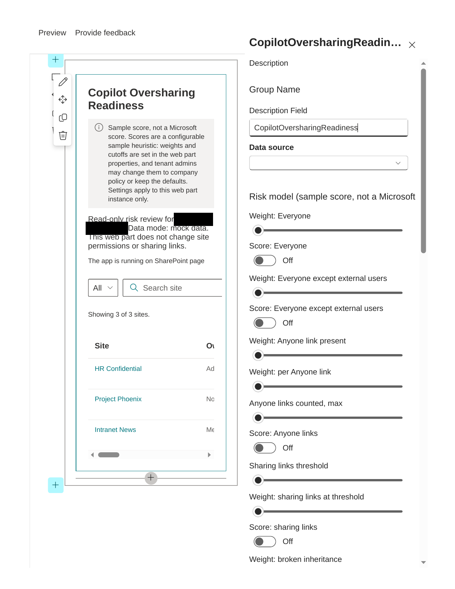

# Copilot Oversharing Readiness

## Summary

Read-only SharePoint web part that reviews site sharing risk before a Microsoft 365 Copilot rollout. It lists sites from SharePoint Search, reads live risk signals from each site with the signed-in user's own access, and lets site owners record an attestation. It never changes site permissions or sharing links.

Scores are a configurable sample heuristic, not a Microsoft score. Microsoft publishes no numeric oversharing score, weights, or High/Medium/Low cutoffs. Tenant admins change every weight, threshold, and cutoff in the web part property pane, or keep the defaults. Settings apply to this web part instance only, not tenant-wide.

## Compatibility

| :warning: Important          |
|:---------------------------|
| Every SPFx version is optimally compatible with specific versions of Node.js. In order to be able to Toolchain this sample, you need to ensure that the version of Node on your workstation matches one of the versions listed in this section. This sample will not work on a different version of Node.|
|Refer to <https://aka.ms/spfx-matrix> for more information on SPFx compatibility.   |

This sample is optimally compatible with the following environment configuration:

-Incompatible-red.svg "SharePoint Server 2016 Feature Pack 2 requires SPFx 1.1")

## Applies to

- [SharePoint Framework](https://aka.ms/spfx)
- [Microsoft 365 tenant](https://docs.microsoft.com/sharepoint/dev/spfx/set-up-your-developer-tenant)

> Get your own free development tenant by subscribing to [Microsoft 365 developer program](http://aka.ms/o365devprogram)

## Solution

| Solution    | Author(s)                                               |
| ----------- | ------------------------------------------------------- |
| react-copilot-oversharing-readiness | [Muhamad Fahrurrozi](https://github.com/afahru) and Muse |

## Version history

| Version | Date             | Comments        |
| ------- | ---------------- | --------------- |
| 1.3.0.0 | November 4, 2026 | Sensitivity labels from the site object, sharing-link counts from Graph site permissions (Sites.Read.All consent required, otherwise Unknown), attestation Status and SiteUrl columns, settings export, import, and reset |
| 1.2.0.0 | November 4, 2026 | Localization: English, Bahasa Indonesia, and Simplified Chinese, following the user's display language with English fallback |
| 1.1.1.0 | November 4, 2026 | Personal-site Search results excluded from the live list, verified live 11 of 11 sites |
| 1.1.0.0 | November 4, 2026 | Configurable risk settings in the property pane, Microsoft-default ordering, Fluent UI 8 list, sensitivity-label scoring off by default, ownership as a flag not a score |
| 1.0.0.0 | November 3, 2026 | Initial release, mock mode and owner attestation |

## Disclaimer

**THIS CODE IS PROVIDED _AS IS_ WITHOUT WARRANTY OF ANY KIND, EITHER EXPRESS OR IMPLIED, INCLUDING ANY IMPLIED WARRANTIES OF FITNESS FOR A PARTICULAR PURPOSE, MERCHANTABILITY, OR NON-INFRINGEMENT.**

---

## Minimal Path to Awesome

- Clone this repository
- Ensure that you are at the solution folder
- in the command-line run:
  - `npm install`
  - `heft start`

## Features

- Live site list from SharePoint Search, with partial live risk per site
- Configurable sample score: weights, inactivity days, sharing-link threshold, Anyone-link handling, High/Medium cutoffs, per-signal toggles, sensitivity-label scoring (off by default), ownership minimum (flag only, default 2)
- Microsoft priority ordering: Fix first (Anyone or Everyone), Review (Everyone except external users), Governance (broken inheritance, single owner, inactivity), Low, Unknown
- Owner attestation, stored in a SharePoint list on the host web with dedicated Status and SiteUrl columns (legacy Title-encoded rows still read)
- Sensitivity label read from the site object, and Anyone-link and sharing-link counts read from Graph site permissions when Sites.Read.All is consented, otherwise reported as Unknown
- Settings export, import, and reset: export the current settings to JSON, import a settings JSON file (unknown keys and wrongly typed values are ignored), or reset to the web part property pane values
- CSV export for auditors, with configurable columns and file name
- Fluent UI 8 list with filter, search, sorting, and accessible risk pills (colour plus text plus icon)
- Localization: English, Bahasa Indonesia, and Simplified Chinese, following the user's display language with English fallback

## How to read the results

Microsoft 365 Copilot surfaces only content that the signed-in user already has permission to access. A site that is shared too broadly therefore becomes a Copilot exposure risk, even when no permission was changed for Copilot itself. Read the results in this order:

- **Fix first:** sites shared with Everyone, Everyone except external users, or Anyone links. Review whether that broad sharing is intended, and restrict it to the groups that require access.
- **Review:** sites with broken permission inheritance. Confirm whether the unique permissions are intentional, and restore inheritance where they are not.
- **Governance:** sites with a single owner, no active owner, or no recent activity. Assign at least two owners and confirm that the site is still required.
- **Unknown:** a signal that could not be read is reported as Unknown, never as zero. An Unknown result is not a pass, it is a gap in the evidence, and the site requires a manual review.
- **Owner attestation:** a site owner confirms that the recorded access is intended, or records that it requires remediation. Attestation is a review record, not a permission change.

This web part is read-only. It does not change site permissions, sharing links, or sensitivity labels. Any remediation is performed separately by a site or tenant administrator.

Live scores exist only where the signed-in user has manage access to a site (Site Collection Admin, Owners group Full Control, or a custom level including Manage Permissions). Read-only access is not enough, because the read inspects role assignments. Sites without that access list with an Unknown verdict, not a Low score.

## Prerequisites

A Microsoft 365 developer tenant or a tenant where you can deploy to the app catalog. No SharePoint Advanced Management licence is required: the sample works without SAM, using the signed-in user's own SharePoint token. Anyone-link and sharing-link counts additionally require Microsoft Graph Sites.Read.All consent; without it, those signals report as Unknown.

## Known limitations

- SharePoint Search is not a complete site inventory. In the test tenant, Search lists 11 sites while the admin center lists 12 active sites: two admin sites return no Search results, so they are not listed by this web part, and the Search result titled Team Site is the content type hub, which does not appear in the admin active-sites list. Sites that are not indexed are not reviewed.
- Anyone-link and sharing-link counts read from Graph site permissions. In the test tenant (verified live with version 1.3.0.0) those signals still report as Unknown even though API access shows Microsoft Graph Sites.Read.All as approved and pre-authorized, so the Graph route needs further debugging and must not be read as zero links.
- Attestation columns Status and SiteUrl are created on the first attestation save after upgrade. A list created by an older version reads its legacy Title-encoded rows until then.

## References

- [Getting started with SharePoint Framework](https://docs.microsoft.com/sharepoint/dev/spfx/set-up-your-developer-tenant)
- [Building for Microsoft teams](https://docs.microsoft.com/sharepoint/dev/spfx/build-for-teams-overview)
- [Use Microsoft Graph in your solution](https://docs.microsoft.com/sharepoint/dev/spfx/web-parts/get-started/using-microsoft-graph-apis)
- [Publish SharePoint Framework applications to the Marketplace](https://docs.microsoft.com/sharepoint/dev/spfx/publish-to-marketplace-overview)
- [Microsoft 365 Patterns and Practices](https://aka.ms/m365pnp) - Guidance, tooling, samples and open-source controls for your Microsoft 365 development
- [Heft Documentation](https://heft.rushstack.io/)

## Contributors

- [Muhamad Fahrurrozi](https://github.com/afahru)
- Muse

