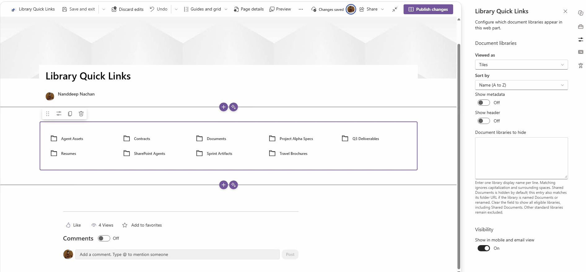
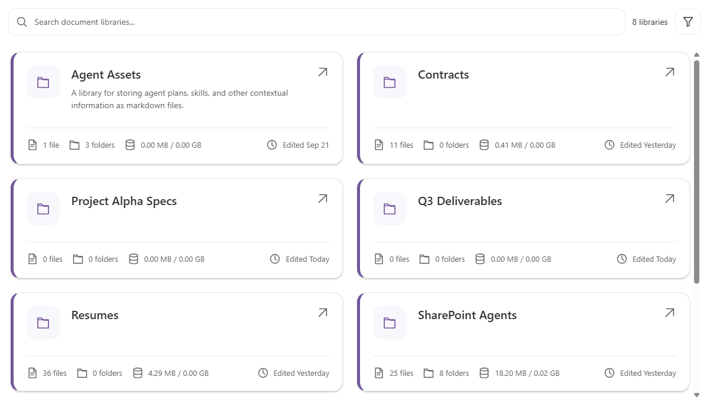

# Library Quick Links Web Part

## Summary

A SharePoint Framework (SPFx) web part that displays document libraries from the current SharePoint site in **Tiles** or **List** layouts. Page authors can configure sorting, library visibility, metadata, and an optional search and filter header. Colors follow the current SharePoint theme.

The out-of-box **Shared Documents** library is supported but hidden by default through **Document libraries to hide**. Remove that entry to display it.



## Features

- **Two layouts** - Responsive tiles or a single-column list, with distinct card and row designs when metadata is enabled.
- **Configurable sorting** - Alphabetical ascending/descending or last-modified oldest/newest first.
- **Optional metadata** - Separate file and folder icons and counts, library size in both MB and GB, and the last item-modified date.
- **Library descriptions** - Shows the SharePoint library description when metadata is enabled and a description is available.
- **Optional header** - Search, result count, and metadata filters; hidden by default.
- **Search and filters** - Search names and descriptions; filter all libraries, libraries with files, or libraries with no files.
- **Library visibility** - Hide libraries by name without changing their permissions.
- **Theme-aware** - Uses SharePoint theme colors for text, accents, backgrounds, borders, and focus indicators.
- **Accessible interaction** - Keyboard-accessible links and scrolling, labeled controls, and visible focus indicators.
- **Paged data retrieval** - Follows additional SharePoint REST result pages.
- **Status feedback** - Loading, empty, no-match, and error states.

## Compatibility

> SPFx releases have specific Node.js requirements. Refer to the
> [SPFx compatibility matrix](https://aka.ms/spfx-matrix) and use a Node.js version
> supported by this sample's dependencies.


- Uses **SPFx 1.24.0-rc.0**, a release-candidate version.
- The Node.js ranges declared in [package.json](./package.json) are
  `>=22.14.0 <23.0.0`, `>=24.0.0 <25.0.0`, or `>=26.0.0 <27.0.0`.
- Requires SharePoint Online; this SPFx version is not compatible with SharePoint Server 2016 or 2019.
- Use the SharePoint-hosted workbench for development. The local workbench is not supported.

## Contributors

* [Nanddeep Nachan](https://github.com/nanddeepn)
* [Smita Nachan](https://github.com/smitanachan)

## Version history

| Version | Date              | Comments        |
| ------- | ----------------- | --------------- |
| 1.0     | November 03, 2026 | Initial release |

## Supported Hosts

The following hosts are declared in the web part manifest:

| Host | Supported |
| ---- | --------- |
| SharePoint Web Part | Yes |
| SharePoint Full-Page App | Yes |
| Microsoft Teams Tab | Yes |
| Microsoft Teams Personal App | Yes |

Library data is loaded from the current SharePoint web supplied by the host context.

## Graph API Permissions

**No Microsoft Graph permissions or additional API access approvals are requested.**
The web part uses the authenticated SharePoint REST API through `SPHttpClient` and respects the current user's access. Hiding a library only removes its link; it does not restrict access to the library.

## Prerequisites

- A Node.js version within the ranges listed under **Compatibility** and npm.
- A Microsoft 365 tenant with SharePoint Online.
- Access to a SharePoint site and its document libraries.
- App Catalog access, or an administrator who can deploy the solution.
- Heft is installed locally by `npm install`; a global installation is not required.

## Getting Started

### 1. Clone and install

```powershell
git clone https://github.com/pnp/sp-dev-fx-webparts.git
Set-Location sp-dev-fx-webparts\samples\library-quick-links
npm install
```

### 2. Run locally

Configure the tenant/workbench URL in [config/serve.json](./config/serve.json), then run:

```powershell
heft start
```

Use the SharePoint-hosted workbench on the site whose libraries you want to display:

```text
https://<tenant>.sharepoint.com/sites/<site>/_layouts/15/workbench.aspx
```

Add **Library Quick Links** to the workbench and open its property pane.

### 3. Build for production

```powershell
heft build --production
```

This command runs the production build and tests, then packages the solution. The package is generated at `release\solution\library-quick-links.sppkg`.

To run the production build and tests without packaging:

```powershell
heft package-solution --production
```

### 4. Deploy

1. Upload `library-quick-links.sppkg` to your SharePoint **App Catalog**.
2. Deploy the solution when prompted.
3. If it is not deployed tenant-wide, add the app to the target site.
4. Edit a modern SharePoint page and add **Library Quick Links**.
5. Configure the web part, then save or republish the page.

## Configuration

Edit the web part to open the **Document libraries** property-pane group.

| Setting | Default | Description |
| ------- | ------- | ----------- |
| **Viewed as** | Tiles | Choose a responsive tile grid or a single-column list. |
| **Sort by** | Name (A to Z) | Choose name ascending/descending or last-modified oldest/newest first. |
| **Show metadata** | Off | Show descriptions, file/folder counts, size, and the edited date. |
| **Show header** | Off | Show search, library count, and the filter button when metadata is enabled. |
| **Document libraries to hide** | Shared Documents | Enter one library display name per line. Clear the field to show all eligible libraries. |



### Sorting

- **Name (A to Z)** and **Name (Z to A)** compare names using the current SharePoint UI locale, ignoring case.
- **Last modified (oldest first)** and **Last modified (newest first)** use `LastItemModifiedDate`.
- Equal dates are ordered by name (A to Z); missing or invalid dates appear last when sorting without metadata.
- Sorting works in both layouts with metadata on or off. Changing the sort order or layout does not reload libraries.

### Header, search, and filters

The header is hidden for new web parts and existing web parts without a saved **Show header** setting.
When enabled:

- Search matches library names and descriptions, ignoring case and surrounding search whitespace.
- The library count reflects search, filters, and hidden-library exclusions.
- With **Show metadata** enabled, the filter button offers **All libraries**, **With files**,
  and **Empty libraries (no files)**. A library containing only folders counts as empty.

Search and filtering do not reload data. Hiding the header clears the search and filter, so no invisible filtering remains. Disabling metadata resets the metadata filter. There are no tile/list switching buttons in the header; use **Viewed as** in the property pane.

### Metadata

Metadata is calculated by paging through library items accessible to the current user:

- File and folder counts include all depths, exclude the library root, and count document sets as folders.
- Each count has its own icon, with files and folders displayed on the same line.
- Size sums current file lengths, **excluding version history**. It is not a total storage-usage report.
- Both size units are shown using 1024-based conversion and two localized decimal places,
  for example `1,024.00 MB / 1.00 GB`.
- The edited date comes from `LastItemModifiedDate`, displayed as **Today**, **Yesterday**,
  or a localized date. Older years include the year; dates use the browser's time zone.

Extra item requests run only when metadata is enabled. Large libraries can take longer to load or encounter SharePoint query limits or throttling. Request failures and invalid metadata are reported as errors rather than incomplete totals. Disabling metadata restores compact links.

### Library visibility

Enter one library display name per line, for example:

```text
Shared Documents
Data Requests
Portfolio Review
```

Matching ignores capitalization and surrounding spaces. Blank lines and unmatched names are ignored; commas and semicolons are treated as part of a name.

The default `Shared Documents` entry also matches the library's root folder URL, so it hides that library even when its display name is **Documents** or has been renamed. Remove this entry, or clear the field, to show it. An explicitly empty saved setting remains empty; web parts without a saved setting use the default.

Other libraries are matched by display name. Update the hide setting if one of those libraries is renamed. Changes apply immediately; save or republish the page to persist them.

### Automatically excluded libraries

Hidden libraries and catalogs are excluded. The following standard library folders are also excluded by root folder URL, even if their display names change:

- SiteAssets
- Style Library
- FormServerTemplates
- SiteCollectionDocuments
- SiteCollectionImages
- PublishingImages
- PreservationHoldLibrary
- Libraries under `_catalogs`

These exclusions cannot be overridden through **Document libraries to hide**.
Shared Documents is not automatically excluded.

## Layout Reference

| Layout | Metadata off | Metadata on |
| ------ | ------------ | ----------- |
| **Tiles** | Responsive grid of compact folder links | Cards with a folder badge, description, accent border, and metadata footer; up to two columns when space permits |
| **List** | One compact folder link per row | Compact rows with small folder icons, descriptions, separators, and metadata alongside the heading, wrapping below on narrow screens |

Libraries open in the same tab. Compact links have a 240px vertical scrolling limit;
metadata layouts have a 560px limit.

## Localization

English (US) UI strings are provided in
[en-us.js](./src/webparts/libraryQuickLinks/loc/en-us.js).
The current SharePoint UI locale is used to format counts, sizes, dates, and alphabetical sorting.
Additional UI translations are not included.

## Technology Stack

| Technology | Purpose |
| ---------- | ------- |
| [SPFx 1.24.0-rc.0](https://aka.ms/spfx) | Web part lifecycle, property pane, context, and theme integration |
| React 18.3.1 | Component rendering and state |
| TypeScript 5.8 | Typed web part and data models |
| SharePoint REST API / `SPHttpClient` | Authenticated library and item retrieval |
| SCSS modules | Responsive layouts and theme-aware styling |
| [Heft](https://heft.rushstack.io/) | Build, test, and packaging toolchain |
| Jest | Data retrieval and component regression tests |

## Disclaimer

**THIS CODE IS PROVIDED _AS IS_ WITHOUT WARRANTY OF ANY KIND, EITHER EXPRESS OR IMPLIED, INCLUDING ANY IMPLIED WARRANTIES OF FITNESS FOR A PARTICULAR PURPOSE, MERCHANTABILITY, OR NON-INFRINGEMENT.**

## References

- [Getting started with SharePoint Framework](https://learn.microsoft.com/sharepoint/dev/spfx/set-up-your-developer-tenant)
- [SPFx compatibility matrix](https://aka.ms/spfx-matrix)
- [Building for Microsoft Teams](https://learn.microsoft.com/sharepoint/dev/spfx/build-for-teams-overview)
- [Working with lists and list items using REST](https://learn.microsoft.com/sharepoint/dev/sp-add-ins/working-with-lists-and-list-items-with-rest)
- [Microsoft 365 Patterns and Practices](https://aka.ms/m365pnp)
- [Heft Documentation](https://heft.rushstack.io/)


