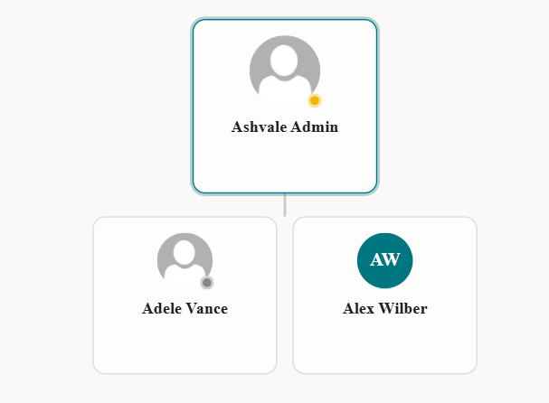
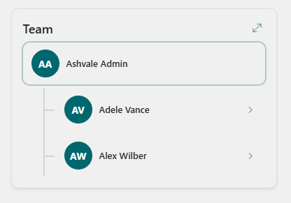

# Org Chart

## Summary

An interactive org chart web part for modern SharePoint. It reads the reporting line from the **user profile service** (PeopleManager), so it works with **no admin consent** by default.

- **Drill through the org** - click any person to re-root the chart on them, with a breadcrumb back to the top.
- **Start from anyone** - a type-ahead people picker in the property pane, or default to the signed-in user.
- **Expand inline** - open a person's team in place (lazy loaded, up to five levels), with the full manager chain shown above.
- **Act on a person** - email, Teams chat, Teams call, or open their profile, straight from the card. No consent needed (Teams deep links).
- **Two views** - a Teams-style vertical list or a horizontal tree.
- **Full-screen explorer** - search for anyone, zoom, and print or save as PDF (print button is optional).
- **Optional live Teams presence** - green / amber / red availability dots via Microsoft Graph, behind an opt-in toggle (off by default).

## Compatibility

## Applies to

- [SharePoint Framework](https://learn.microsoft.com/sharepoint/dev/spfx/sharepoint-framework-overview)
- [Microsoft 365 tenant](https://learn.microsoft.com/sharepoint/dev/spfx/set-up-your-dev-environment)

> Get your own free development tenant by subscribing to [Microsoft 365 developer program](https://aka.ms/m365/devprogram)

## Prerequisites

A SharePoint Online site. The reporting line comes from user profiles, so for a real chart the **Manager** attribute should be set on users (it flows into the profile service from Microsoft Entra ID). With sample data on (the default) the web part renders immediately with no setup.

## Contributors

- [Vijay Kumar Gilakattula](https://github.com/gvijaikumar9)

## Version history

| Version | Date | Comments |
| ------- | ---- | -------- |
| 1.0 | October 31, 2026 | Initial release |

## Minimal Path to Awesome

- Clone this repository (or [download this solution as a .ZIP file](https://pnp.github.io/download-partial/?url=https://github.com/pnp/sp-dev-fx-webparts/tree/main/samples/react-org-chart) then unzip it)
- From your command line, change your current directory to the directory containing this sample (`react-org-chart`, located under `samples`)
- In the command line run:
  - `npm install`
  - `gulp bundle --ship`
  - `gulp package-solution --ship`
- Upload `sharepoint/solution/react-org-chart.sppkg` to your tenant or site collection **App Catalog** and deploy it
- Add the **Org Chart** web part to a page
- In the property pane, turn **Use sample data** off to show the live reporting line, and optionally set **Start from** to any person

## Features

This web part illustrates the following concepts:

- Reading the reporting line (manager chain and direct reports) from the SharePoint **user profile service** with no admin consent
- A dependency-free, type-ahead **people picker** as a custom property-pane field, backed by the client people-picker service
- An interactive, lazy-loading tree with drill-down, breadcrumb and inline expand / collapse
- A full-screen, theme-aware dialog (focus trap, Escape to close) with search, zoom and print
- Teams deep links for chat and call, and `mailto:` and profile links, with no permissions
- Optional Microsoft Graph integration for live Teams presence, requested through `webApiPermissionRequests` and used only when the admin approves it and the author enables it

## Optional: live Teams presence

Presence dots are off by default. To enable them, turn on **Live Teams presence** in the property pane and have a tenant admin approve the two Microsoft Graph permissions the package requests (`Presence.Read.All` and `User.ReadBasic.All`) in the SharePoint admin center under **Advanced > API access**. Left off, the web part needs no consent at all.

## Disclaimer

**THIS CODE IS PROVIDED _AS IS_ WITHOUT WARRANTY OF ANY KIND, EITHER EXPRESS OR IMPLIED, INCLUDING ANY IMPLIED WARRANTIES OF FITNESS FOR A PARTICULAR PURPOSE, MERCHANTABILITY, OR NON-INFRINGEMENT.**

