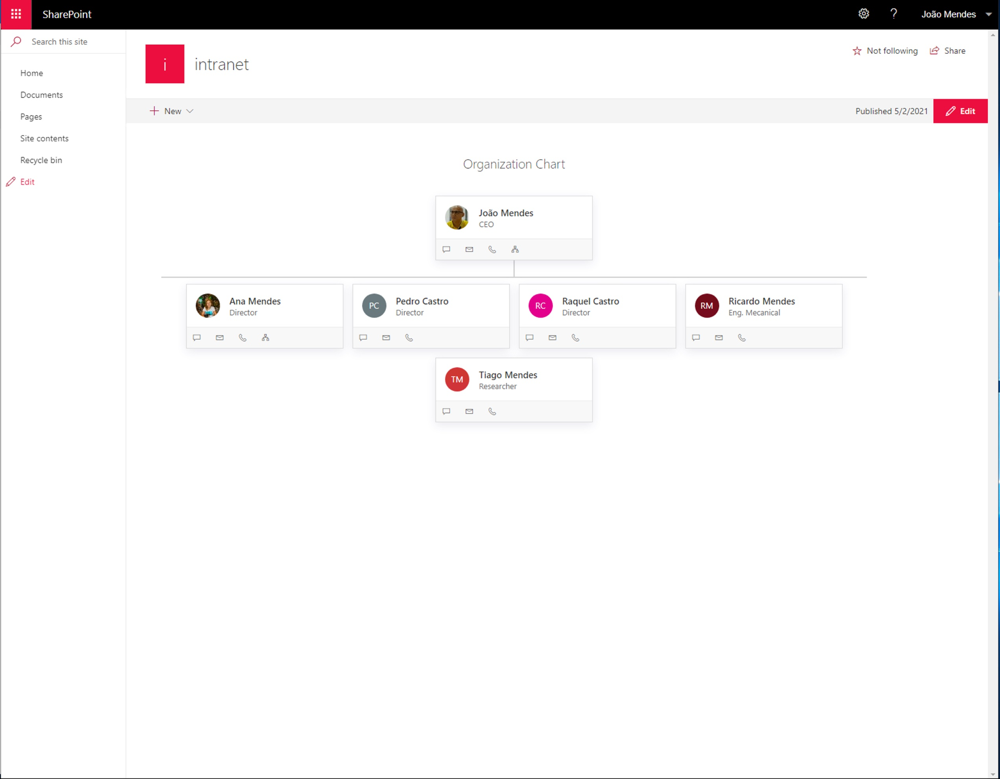
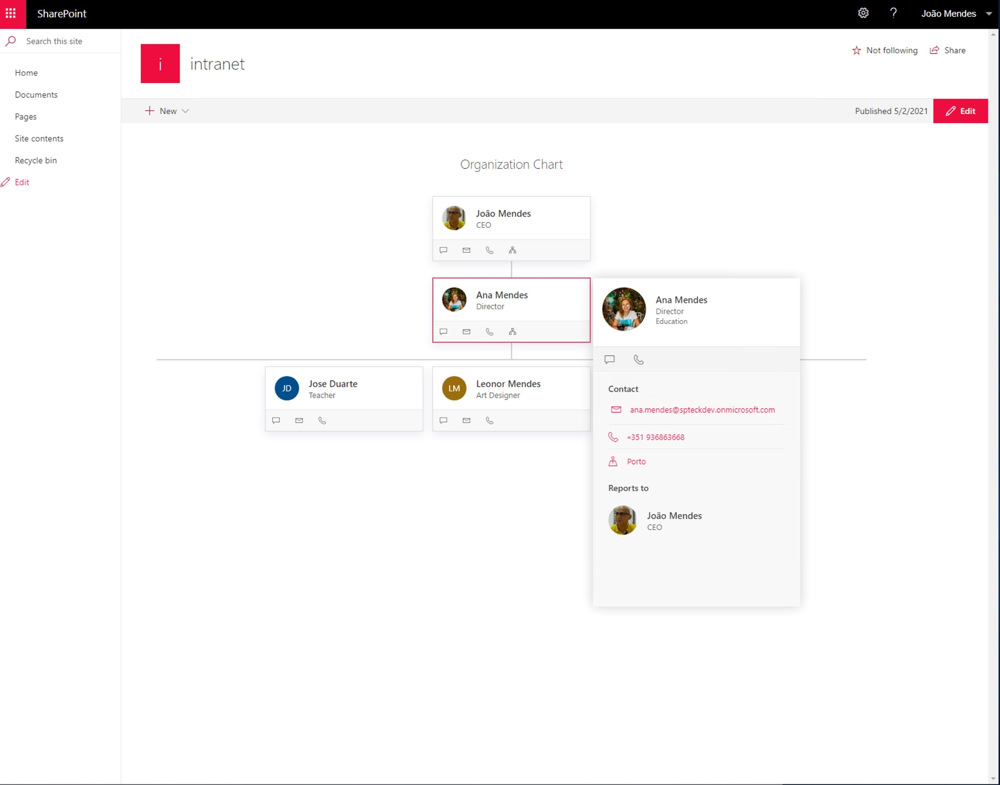

# Organization Chart

## Summary

This web part shows an organization chart based on specified user, and user can navigate to show company organization. This version targets SharePoint Online.






## Compatibility

| :warning: Important          |
|:---------------------------|
| Every SPFx version is optimally compatible with specific versions of Node.js. In order to be able to build this sample, you need to ensure that the version of Node on your workstation matches one of the versions listed in this section. This sample will not work on a different version of Node.|
|Refer to <https://aka.ms/spfx-matrix> for more information on SPFx compatibility.   |

This sample is optimally compatible with the following environment configuration:


-Incompatible-red.svg "SharePoint Server 2016 Feature Pack 2 requires SPFx 1.1")


This sample uses the SPFx 1.24.0 with React and React DOM 18.3.1. The web part uses the React 18 root API. The SPFx toolchain supports Node.js 22.14.0 or later
in the 22.x line, 24.x, and 26.x. The Node.js version used for this sample is pinned to 24.x in `.nvmrc`
(run `nvm use` to switch to it). The development container uses Node.js 22 and installs the local Heft toolchain.
Npm overrides align the existing PnP controls to the web part's React and React DOM
versions and keep React types consistent. SPFx's internal loader retains its own
React dependencies, as in the reference scaffold.

## Applies to

- [SharePoint Framework](https://aka.ms/spfx)

## Contributors


- [João Mendes](https://github.com/joaojmendes)
- [Passoli Mirko](https://github.com/Paxol)
- [Peter Paul Kirschner](https://github.com/petkir)

## Version history

|Version|Date|Comments|
|-------|----|--------|
|1.5|Oct, 2026|SPFx 1.24.0|
|1.4|Dec, 2025|SPFx 1.22.1 + other libs|
|1.3|Oct, 2025|SPFx 1.21.1 PnPjs upgrade|
|1.2|Oct, 2024|SPFx 1.20.0|
|1.1|Feb, 2024|Guest user filter + update to SPFx 1.18.2|
|1.0|May, 2021|Initial release|

## Prerequisites

No pre-requisites

## Minimal Path to Awesome

- Clone this repository
- Ensure that you are at the solution folder
- in the command-line run:
  - `npm install`
  - `npm run start`

To validate and package the solution:

```sh
npm run build -- --production
npm test -- --production
npm run package-solution -- --production
```

>  This sample can also be opened with [VS Code Remote Development](https://code.visualstudio.com/docs/remote/remote-overview). Visit https://aka.ms/spfx-devcontainer for further instructions.

## Features

This web part shows how to use PnPjs, Office-ui-fabric-react to create an Organization Chart

This extension illustrates the following concepts:

## Help

We do not support samples, but we do use GitHub to track issues and constantly want to improve these samples.

You can try looking at [issues related to this sample](https://github.com/pnp/sp-dev-fx-webparts/issues?q=label%3A%22sample%3A%20react-organization-chart") to see if anybody else is having the same issues.

You can also try looking at [discussions related to this sample](https://github.com/pnp/sp-dev-fx-webparts/discussions?discussions_q=react-organization-chart) and see what the community is saying.

If you encounter any issues while using this sample, [create a new issue](https://github.com/pnp/sp-dev-fx-webparts/issues/new?assignees=&labels=Needs%3A+Triage+%3Amag%3A%2Ctype%3Abug-suspected%2Csample%3A%20react-organisation-chart&template=bug-report.yml&sample=react-organisation-chart&authors=@joaojmendes&title=react-organisation-chart%20-%20).

For questions regarding this sample, [create a new question](https://github.com/pnp/sp-dev-fx-webparts/issues/new?assignees=&labels=Needs%3A+Triage+%3Amag%3A%2Ctype%3Aquestion%2Csample%3A%20react-organisation-chart&template=question.yml&sample=react-organisation-chart&authors=@joaojmendes&title=react-organisation-chart%20-%20).

Finally, if you have an idea for improvement, [make a suggestion](https://github.com/pnp/sp-dev-fx-webparts/issues/new?assignees=&labels=Needs%3A+Triage+%3Amag%3A%2Ctype%3Aenhancement%2Csample%3A%20react-organisation-chart&template=question.yml&sample=react-organisation-chart&authors=@joaojmendes&title=react-organisation-chart%20-%20).

## Disclaimer

**THIS CODE IS PROVIDED *AS IS* WITHOUT WARRANTY OF ANY KIND, EITHER EXPRESS OR IMPLIED, INCLUDING ANY IMPLIED WARRANTIES OF FITNESS FOR A PARTICULAR PURPOSE, MERCHANTABILITY, OR NON-INFRINGEMENT.**


