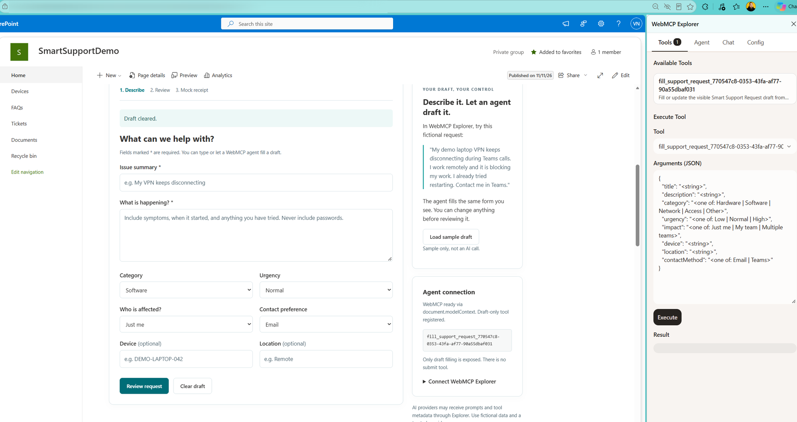
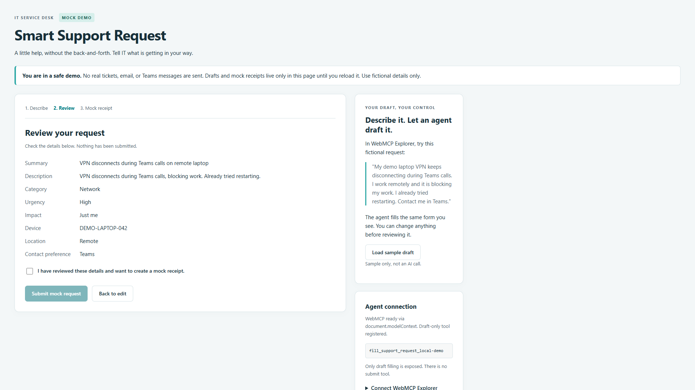

# Smart Support Request

## Summary

A mock IT support form with optional browser WebMCP draft filling, built with React and the SharePoint Framework. An agent can update visible form fields, but reviewing and creating an in-memory mock receipt remain separate page controls. Manual entry works without WebMCP, an extension, or an AI provider.

The contributor confirmed operation on SharePoint Online. This screenshot shows the deployed web part and WebMCP Explorer discovering its draft-filling tool; the address-bar URL is obscured.



## Compatibility

| :warning: Important |
|:--------------------|
| Use a Node.js version supported by this SPFx release. This sample pins the tested Node.js version in `.nvmrc`. |
| Refer to <https://aka.ms/spfx-matrix> for SPFx compatibility information. |


The standalone local preview and automated browser tests use the same React component, not a hosted SharePoint runtime. SharePoint operation is contributor-confirmed, not independently tenant-tested by the automated suite. Teams, full-page hosting, and remote containers have not been verified. This SPFx version is not compatible with SharePoint Server 2016 or 2019. Use a modern SharePoint page rather than the deprecated Online workbench.

WebMCP is experimental. The optional agent workflow requires an Edge build exposing the WebMCP testing API and WebMCP Explorer. Manual form operation does not require either.

## Applies to

* [SharePoint Framework](https://learn.microsoft.com/sharepoint/dev/spfx/sharepoint-framework-overview)
* [Microsoft 365 tenant](https://learn.microsoft.com/sharepoint/dev/spfx/set-up-your-development-environment)

> Get your own development tenant through the [Microsoft 365 developer program](https://aka.ms/m365/devprogram), subject to program eligibility.

## Contributors

* [Valeras Narbutas](https://github.com/ValerasNarbutas)

## Version history

| Version | Date | Comments |
|---------|------|----------|
| 1.0 | November 11, 2026 | Initial sample contribution |

## Prerequisites

* Node.js **v22.18.0** and npm.
* A Microsoft 365 tenant and app-catalog permissions for SharePoint deployment, or use the tenant-free local preview.
* For optional agent-assisted draft filling: Edge with **WebMCP for testing** enabled, WebMCP Explorer, and a tool-calling provider. The [setup guide](docs/SETUP.md) includes the verified local Ollama `qwen3:4b` route, exact-extension origin configuration, and troubleshooting.

No SharePoint list, backend, Graph permissions, or other API permissions are required. No AI SDK or provider credentials are embedded in the web part. Use fictional information: Explorer can send prompts, tool metadata, and results to its configured provider.

## Minimal path to awesome

1. Clone this repository, or [download this solution as a ZIP file](https://pnp.github.io/download-partial/?url=https://github.com/pnp/sp-dev-fx-webparts/tree/main/samples/react-smart-support-request) and unzip it.
2. Change to `samples\react-smart-support-request`, select the Node.js version from `.nvmrc`, and run:

   ```powershell
   npm ci
   npm run preview
   ```

3. Open `http://127.0.0.1:5173` in Edge. This is a standalone local preview, not SharePoint.
4. Select **Load sample draft**, or enter fictional details. Select **Review request**, inspect the summary, confirm the review checkbox, and select **Submit mock request**. The `MOCK-...` receipt exists only in memory.
5. Follow the [Edge, Explorer, and Ollama setup guide](docs/SETUP.md#test-with-edge-and-webmcp-explorer) to try agent-assisted drafting.

For SharePoint, follow [Run in SharePoint](docs/SETUP.md#run-in-sharepoint): update `config\serve.json` to your modern development page, trust the development certificate, set `SPFX_SERVE_TENANT_DOMAIN`, and run `npm start`. Enable debugging only for your trusted local server. To deploy, run `npm run build`, upload the generated `sharepoint\solution\smart-support-request.sppkg` to your app catalog, and add **Smart Support Request** to a modern page. Generated packages are not included in this repository.

For production build checks and local Edge regression tests:

```powershell
npm run build
npm run test:e2e
```

The browser suite requires Microsoft Edge installed and enables its experimental WebMCP testing features. It tests the local preview, including native tool registration and lifecycle cleanup; it does not automate a SharePoint tenant.

## Features

This sample illustrates:

* React form state with validation, a review summary, explicit confirmation, and an in-memory mock receipt.
* Draft-only WebMCP tools registered through `document.modelContext`, with a legacy `navigator.modelContext` fallback.
* Atomic runtime validation of structured tool arguments and partial updates that preserve omitted fields.
* Unique per-instance tool names and cleanup on unmount using `AbortSignal` or the legacy unregister API.
* Human review invalidated by every draft change, including agent updates.
* A manual workflow that remains usable when WebMCP is unavailable.

There are no real IT tickets, outbound submission calls, or persistent drafts. Reloading discards draft and receipt state. This cooperative review workflow is not a security barrier against agents that can also operate arbitrary page controls.

### SharePoint demo

[Watch the contributor-supplied SharePoint demo](assets/sharepoint-demo.mp4). This is the original recording supplied by the contributor; unlike the primary screenshot, its address-bar URL is not obscured.

### Standalone local-preview walkthrough

[Watch the local-preview walkthrough](assets/support-demo.webm). This separate recording uses the real local form and native Edge WebMCP API with arguments generated by local Ollama `qwen3:4b`. Review confirmation and mock submission are automated page actions in this walkthrough. It is not a SharePoint-hosted capture or an Explorer Chat recording.



[Draft screenshot](assets/support-draft.png) | [Mock receipt screenshot](assets/support-receipt.png)

<!--
RESERVED FOR REPO MAINTAINERS

We'll add the video from the community call recording here

## Video

[](https://www.youtube.com/watch?v=XXXXX "YouTube video title")
-->

## Help

We do not support samples, but this community is always willing to help, and we want to improve these samples. We use GitHub to track issues, which makes it easy for community members to volunteer their time and help resolve issues.

If you're having issues building the solution, please run [spfx doctor](https://pnp.github.io/cli-microsoft365/cmd/spfx/spfx-doctor/) from within the solution folder to diagnose incompatibility issues with your environment.

You can try looking at [issues related to this sample](https://github.com/pnp/sp-dev-fx-webparts/issues?q=label%3A%22sample%3A%20react-smart-support-request%22) to see if anybody else is having the same issues.

You can also try looking at [discussions related to this sample](https://github.com/pnp/sp-dev-fx-webparts/discussions?discussions_q=react-smart-support-request) and see what the community is saying.

If you encounter any issues using this sample, [create a new issue](https://github.com/pnp/sp-dev-fx-webparts/issues/new?assignees=&labels=Needs%3A+Triage+%3Amag%3A%2Ctype%3Abug-suspected%2Csample%3A%20react-smart-support-request&template=bug-report.yml&sample=react-smart-support-request&authors=@ValerasNarbutas&title=react-smart-support-request%20-%20).

For questions regarding this sample, [create a new question](https://github.com/pnp/sp-dev-fx-webparts/issues/new?assignees=&labels=Needs%3A+Triage+%3Amag%3A%2Ctype%3Aquestion%2Csample%3A%20react-smart-support-request&template=question.yml&sample=react-smart-support-request&authors=@ValerasNarbutas&title=react-smart-support-request%20-%20).

Finally, if you have an idea for improvement, [make a suggestion](https://github.com/pnp/sp-dev-fx-webparts/issues/new?assignees=&labels=Needs%3A+Triage+%3Amag%3A%2Ctype%3Aenhancement%2Csample%3A%20react-smart-support-request&template=suggestion.yml&sample=react-smart-support-request&authors=@ValerasNarbutas&title=react-smart-support-request%20-%20).

## Disclaimer

**THIS CODE IS PROVIDED *AS IS* WITHOUT WARRANTY OF ANY KIND, EITHER EXPRESS OR IMPLIED, INCLUDING ANY IMPLIED WARRANTIES OF FITNESS FOR A PARTICULAR PURPOSE, MERCHANTABILITY, OR NON-INFRINGEMENT.**

<!-- Required by PnP validation. Keep this as the final line, use an HTML img tag, and make the URL suffix match the repository-relative sample path. -->

