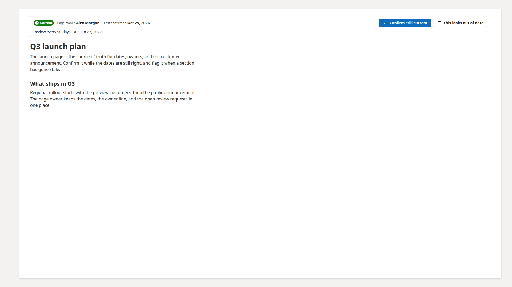
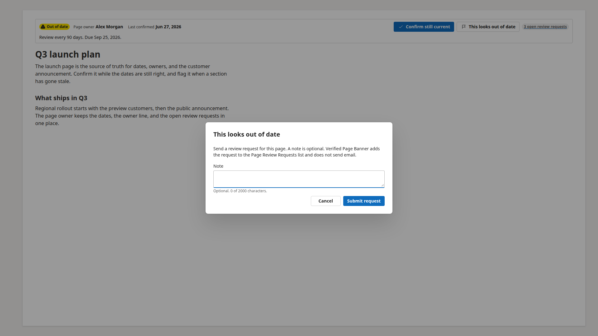
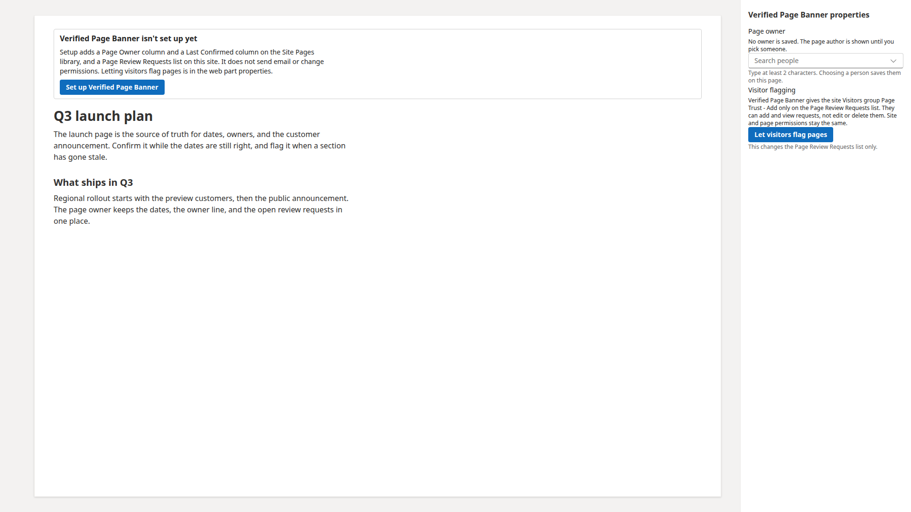

# Verified Page Banner

## Summary

**Verified Page Banner** sits at the top of a modern SharePoint page and shows whether the page is still current. The page owner, or anyone who can edit the page, selects **Confirm still current**. Readers select **This looks out of date** to add a request to the **Page Review Requests** list. A site owner can let visitors add those requests from the property pane, and can turn that access off again.

The sample is built with SharePoint Framework 1.23.2, the Heft toolchain, React 17, Fluent UI, and PnPjs. It calls the current site only. It does not call Microsoft Graph and it does not request API permissions. The package version is 1.1.3.

## Compatibility

| :warning: Important          |
|:---------------------------|
| Every SPFx version is optimally compatible with specific versions of Node.js. In order to be able to build this sample, you need to ensure that the version of Node on your workstation matches one of the versions listed in this section. This sample will not work on a different version of Node.|
|Refer to <https://aka.ms/spfx-matrix> for more information on SPFx compatibility.   |

This sample is optimally compatible with the following environment configuration:

-Incompatible-red.svg "SharePoint Server 2016 Feature Pack 2 requires SPFx 1.1")

## Applies to

* [SharePoint Framework](https://learn.microsoft.com/sharepoint/dev/spfx/sharepoint-framework-overview)
* [Microsoft 365 tenant](https://learn.microsoft.com/sharepoint/dev/spfx/set-up-your-development-environment)

> Get your own free development tenant by subscribing to [Microsoft 365 developer program](https://aka.ms/m365/devprogram)

## Contributors

* [Anand Vijayaragavan](https://github.com/anandragav)

## Version history

|Version|Date|Comments|
|-------|----|--------|
|1.0|October 25, 2026|Initial release|

## Prerequisites

Node.js v22.14.0, as listed in `.nvmrc`. A SharePoint Online site where you can add an app and edit a modern page.

You do not create the lists or columns by hand. The first time a site owner opens a page with this web part, they select **Set up Verified Page Banner**. That one action provisions everything below. It does not send email, and it does not change site or page permissions.

**Site Pages** columns:

|Display name|Internal name|Type|
|------------|-------------|----|
|Page Owner|`PageOwner`|Person, people only|
|Last Confirmed|`LastConfirmed`|Date only|

**Page Review Requests** list:

|Display name|Internal name|Type|
|------------|-------------|----|
|Title|`Title`|Single line of text, the page title|
|Page title|`PageTitle`|Single line of text|
|Page link|`PageLink`|Multiple lines of plain text, the absolute page URL|
|Page key|`PageKey`|Single line of text, indexed, the server-relative page path|
|Flagged by|`FlaggedBy`|Person|
|Note|`Note`|Multiple lines of plain text, optional|
|Status|`Status`|Choice. Default **New**. Also **In review** and **Resolved**|

Visitor flagging is off until a site owner turns it on in the property pane. **Let visitors flag pages** creates a permission level named **Page Trust - Add only** (add and view, without edit or delete) and grants it to the site **Visitors** group on the **Page Review Requests** list only. **Stop letting visitors flag pages** removes that role assignment and leaves every other permission on the list in place. No Microsoft Graph permission and no tenant admin API permission is required.

## Minimal path to awesome

* Clone this repository (or [download this solution as a .ZIP file](https://pnp.github.io/download-partial/?url=https://github.com/pnp/sp-dev-fx-webparts/tree/main/samples/react-verified-page-banner) then unzip it)
* From your command line, change your current directory to the directory containing this sample (`react-verified-page-banner`, located under `samples`)
* In the command line run:
  * `npm install`
  * `npm run start`
* Open the hosted workbench on a modern SharePoint page, add **Verified Page Banner**, and select **Set up Verified Page Banner**
* To test and package without starting the workbench, run:
  * `npx heft test --clean`
  * `npx heft package-solution --production`
* Upload `sharepoint/solution/react-verified-page-banner.sppkg` to the tenant app catalog and add the web part to a modern page

> This sample can also be opened with [VS Code Remote Development](https://code.visualstudio.com/docs/remote/remote-overview). Visit <https://aka.ms/spfx-devcontainer> for further instructions.

## Features

The banner shows a green **Current** status while **Last Confirmed** is inside the review period, and an amber **Out of date** status after that. A page that has never been confirmed is amber and labeled **Not confirmed**. The review period is a web part property, in days, and the default is 90. The due day itself is still current.

**Confirm still current** writes today's date to **Last Confirmed**. When no **Page Owner** is saved, the page author is treated as the owner for that button and the banner says **Author (no owner set)**.

**This looks out of date** opens a dialog. The note is optional. The web part adds one **New** item to **Page Review Requests** with the page URL, the page title, and the current user. It does not send email.

People who can edit the page, and the page owner, see a badge such as **3 open review requests** when at least one request for this page is still **New**. The badge links to the list filtered to this page. It is hidden when the count is 0.

The property pane has two groups:

* **Verified Page Banner** holds the review period and the **Page owner** people picker.
* **Visitors** holds **Let visitors flag pages** and, once that grant exists, **Stop letting visitors flag pages**.

### Page owner while the page is locked

A modern page in Edit mode is locked for shared use. Writing the **Page Owner** column with `items.update` or `validateUpdateListItem` then returns HTTP 423 (`-2147018894`, locked for shared use).

The web part stores the selected person on the web part properties first (`ownerId`, `ownerLoginName`, `ownerEmail`, `ownerDisplayName`). SharePoint saves those properties with the page, so the banner updates immediately. The column write still uses `ensureUser` and `validateUpdateListItem` with a people-picker value of `[{"Key":"<site login>"}]`. When SharePoint returns HTTP 423, the property pane confirms the owner and the column is written later, when the page is no longer locked. In Read mode that sync runs quietly. Clearing the owner is stored the same way and the banner falls back to the page author.

### How this complements other samples

|Sample concern|Verified Page Banner|List and page samples already in this repository|
|--------------|--------------------|--------------------------------------------------|
|Is this page still current|**Current**, **Out of date**, or **Not confirmed**, from **Last Confirmed** and the review period|Samples such as page navigators and list viewers show content. They do not track a confirmation date.|
|Who should review it|**Page owner**, saved on the page, with the author as a display fallback|Ownership is usually a list column the reader has to open.|
|Ask for a review|**This looks out of date** writes a **Page Review Requests** item. No mail is sent.|A list form sample can edit items. It does not know which page the reader is on.|
|Let visitors participate|Optional **Page Trust - Add only** on that one list. Site and page permissions stay as they are.|Many samples rely on the rights the reader already has.|

The web part does not replace SharePoint page approval, publishing, or modern page comments. It answers a smaller question: who owns this page, and when did someone last say it was still current.

This web part illustrates the following concepts on top of the SharePoint Framework:

* a React 17 client-side web part styled with Fluent UI and the SharePoint theme
* provisioning list and library columns from the web part, idempotently, with no tenant permission
* reading and writing the current page list item with PnPjs
* keeping a person field in web part properties when `validateUpdateListItem` is blocked by a shared file lock
* breaking role inheritance on one list and granting a custom permission level to the Visitors group

## Help

We do not support samples, but this community is always willing to help, and we want to improve these samples. We use GitHub to track issues, which makes it easy for community members to volunteer their time and help resolve issues.

If you're having issues building the solution, please run [spfx doctor](https://pnp.github.io/cli-microsoft365/cmd/spfx/spfx-doctor/) from within the solution folder to diagnose incompatibility issues with your environment.

You can try looking at [issues related to this sample](https://github.com/pnp/sp-dev-fx-webparts/issues?q=label%3A%22sample%3A%20react-verified-page-banner%22) to see if anybody else is having the same issues.

You can also try looking at [discussions related to this sample](https://github.com/pnp/sp-dev-fx-webparts/discussions?discussions_q=react-verified-page-banner) and see what the community is saying.

If you encounter any issues using this sample, [create a new issue](https://github.com/pnp/sp-dev-fx-webparts/issues/new?assignees=&labels=Needs%3A+Triage+%3Amag%3A%2Ctype%3Abug-suspected%2Csample%3A%20react-verified-page-banner&template=bug-report.yml&sample=react-verified-page-banner&authors=@anandragav&title=react-verified-page-banner%20-%20).

For questions regarding this sample, [create a new question](https://github.com/pnp/sp-dev-fx-webparts/issues/new?assignees=&labels=Needs%3A+Triage+%3Amag%3A%2Ctype%3Aquestion%2Csample%3A%20react-verified-page-banner&template=question.yml&sample=react-verified-page-banner&authors=@anandragav&title=react-verified-page-banner%20-%20).

Finally, if you have an idea for improvement, [make a suggestion](https://github.com/pnp/sp-dev-fx-webparts/issues/new?assignees=&labels=Needs%3A+Triage+%3Amag%3A%2Ctype%3Aenhancement%2Csample%3A%20react-verified-page-banner&template=suggestion.yml&sample=react-verified-page-banner&authors=@anandragav&title=react-verified-page-banner%20-%20).

## Disclaimer

**THIS CODE IS PROVIDED *AS IS* WITHOUT WARRANTY OF ANY KIND, EITHER EXPRESS OR IMPLIED, INCLUDING ANY IMPLIED WARRANTIES OF FITNESS FOR A PARTICULAR PURPOSE, MERCHANTABILITY, OR NON-INFRINGEMENT.**

