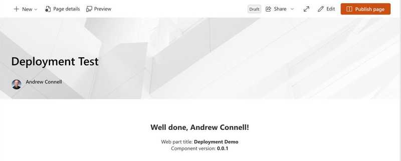

# Deploy SharePoint Framework components to production

## Summary

A SharePoint Framework (SPFx) solution that you package and deploy to the tenant and site collection app catalogs, then extend with more components and new package and component versions. This tutorial contains the completed code for the exercises in the Microsoft Learn module [Deploy SharePoint Framework components to production](https://learn.microsoft.com/training/modules/sharepoint-spfx-deployment/).

The root of this folder contains the completed solution at the end of the last exercise in the module, Version numbers in SharePoint Framework projects, packages, and components.

The `checkpoints` folder contains the code as it was at the end of each earlier exercise:

* [Deploy SharePoint Framework solutions to tenant App Catalog](checkpoints/3-exercise-deploy-tenant-app-catalog/README.md)

## Compatibility

| :warning: Important          |
|:---------------------------|
| Every SPFx version is optimally compatible with specific versions of Node.js. In order to be able to Toolchain this sample, you need to ensure that the version of Node on your workstation matches one of the versions listed in this section. This sample will not work on a different version of Node.|
|Refer to <https://aka.ms/spfx-matrix> for more information on SPFx compatibility.   |

This tutorial is optimally compatible with the following environment configuration:

-Incompatible-red.svg "SharePoint Server 2016 Feature Pack 2 requires SPFx 1.1")

## Applies to

* [SharePoint Framework](https://learn.microsoft.com/sharepoint/dev/spfx/sharepoint-framework-overview)
* [Microsoft 365 tenant](https://learn.microsoft.com/sharepoint/dev/spfx/set-up-your-development-environment)
* [Microsoft Learn: Deploy SharePoint Framework components to production](https://learn.microsoft.com/training/modules/sharepoint-spfx-deployment/)

> Get your own free development tenant by subscribing to [Microsoft 365 developer program](https://aka.ms/m365/devprogram)

## Contributors

* [Andrew Connell](https://github.com/andrewconnell)

## Version history

|Version|Date|Comments|
|-------|----|--------|
|1.0|November 25, 2026|Initial release|

## Prerequisites

* A SharePoint Online tenant with a tenant app catalog
* Permission to create a site collection app catalog, for example with the CLI for Microsoft 365 or SharePoint Online Management Shell

## Minimal path to awesome

* Clone this repository, or [download this tutorial as a .ZIP file](https://pnp.github.io/download-partial/?url=https://github.com/pnp/sp-dev-fx-webparts/tree/main/tutorials/mslearn-module-deployment) and unzip it.
* From your command line, change to the `tutorials/mslearn-module-deployment` folder.
* Ensure that you're using a supported Node.js version. If you use nvm, run `nvm use`.
* Set the `SPFX_SERVE_TENANT_DOMAIN` environment variable to your SharePoint Online domain, for example `contoso.sharepoint.com`. If `config/serve.json` contains `<site-name>` or a site path, change it to a site you can test on.
* In the command line, run:
  * `npm install`
  * `npm run start`
* To build a deployable package, run `npm run build`. The package is saved in the `sharepoint/solution` folder.

## Features

This tutorial illustrates the following concepts on top of the SharePoint Framework:

* Packaging a solution for production with `heft package-solution --production`
* Deploying to the tenant app catalog and to a site collection app catalog
* Adding a second web part and a command set to an existing project
* Changing package and component version numbers and upgrading an installed app

## Help

We do not support samples, but this community is always willing to help, and we want to improve these samples. We use GitHub to track issues, which makes it easy for community members to volunteer their time and help resolve issues.

If you're having issues building the solution, please run [spfx doctor](https://pnp.github.io/cli-microsoft365/cmd/spfx/spfx-doctor/) from within the solution folder to diagnose incompatibility issues with your environment.

You can try looking at [issues related to this tutorial](https://github.com/pnp/sp-dev-fx-webparts/issues?q=label%3A%22sample%3A%20mslearn-module-deployment%22) to see if anybody else is having the same issues.

You can also try looking at [discussions related to this tutorial](https://github.com/pnp/sp-dev-fx-webparts/discussions?discussions_q=mslearn-module-deployment) and see what the community is saying.

If you encounter any issues using this tutorial, [create a new issue](https://github.com/pnp/sp-dev-fx-webparts/issues/new?assignees=&labels=Needs%3A+Triage+%3Amag%3A%2Ctype%3Abug-suspected%2Csample%3A%20mslearn-module-deployment&template=bug-report.yml&sample=mslearn-module-deployment&authors=@andrewconnell&title=mslearn-module-deployment%20-%20).

For questions regarding this tutorial, [create a new question](https://github.com/pnp/sp-dev-fx-webparts/issues/new?assignees=&labels=Needs%3A+Triage+%3Amag%3A%2Ctype%3Aquestion%2Csample%3A%20mslearn-module-deployment&template=question.yml&sample=mslearn-module-deployment&authors=@andrewconnell&title=mslearn-module-deployment%20-%20).

Finally, if you have an idea for improvement, [make a suggestion](https://github.com/pnp/sp-dev-fx-webparts/issues/new?assignees=&labels=Needs%3A+Triage+%3Amag%3A%2Ctype%3Aenhancement%2Csample%3A%20mslearn-module-deployment&template=suggestion.yml&sample=mslearn-module-deployment&authors=@andrewconnell&title=mslearn-module-deployment%20-%20).

## Disclaimer

**THIS CODE IS PROVIDED *AS IS* WITHOUT WARRANTY OF ANY KIND, EITHER EXPRESS OR IMPLIED, INCLUDING ANY IMPLIED WARRANTIES OF FITNESS FOR A PARTICULAR PURPOSE, MERCHANTABILITY, OR NON-INFRINGEMENT.**

