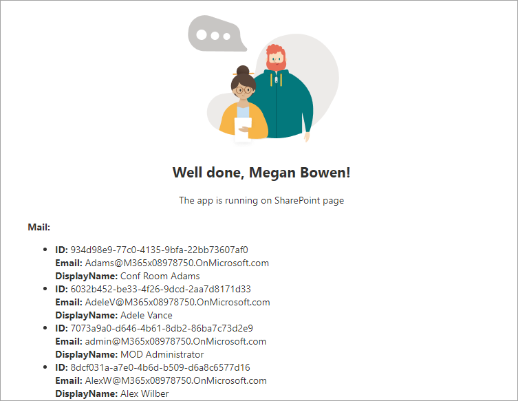

# Use Microsoft Graph and non-Microsoft APIs in SharePoint Framework solutions

## Summary

SharePoint Framework (SPFx) client-side web parts that call an anonymous REST API, a REST API secured with Microsoft Entra ID, and Microsoft Graph. This tutorial contains the completed code for the exercises in the Microsoft Learn module [Use Microsoft Graph and non-Microsoft APIs in SharePoint Framework solutions](https://learn.microsoft.com/training/modules/sharepoint-spfx-graph-3rd-party-apis/).

Each exercise in the module builds its own project. Each project folder contains the completed solution for its exercise. When an exercise builds on an earlier one, the `checkpoints` folder in the project contains the code as it was at the end of that earlier exercise.

| Folder | Microsoft Learn exercise | What it shows |
|---|---|---|
| [SPFxHttpClient](SPFxHttpClient/README.md) | Call anonymous non-Microsoft REST APIs | Calls the anonymous NASA Image REST API and shows an Apollo 4 image. |
| [SPFxAadHttpClient](SPFxAadHttpClient/README.md) | Call Microsoft Entra ID secured REST APIs | Calls Microsoft Graph with `AadHttpClient` and lists users in your directory. |
| [MSGraphSPFx](MSGraphSPFx/README.md) | Call Microsoft Graph from SharePoint Framework components | Calls Microsoft Graph with `MSGraphClientV3` and shows the current user in a Persona card. |

## Compatibility

| :warning: Important          |
|:---------------------------|
| Every SPFx version is optimally compatible with specific versions of Node.js. In order to be able to Toolchain this sample, you need to ensure that the version of Node on your workstation matches one of the versions listed in this section. This sample will not work on a different version of Node.|
|Refer to <https://aka.ms/spfx-matrix> for more information on SPFx compatibility.   |

This tutorial is optimally compatible with the following environment configuration:

-Incompatible-red.svg "SharePoint Server 2016 Feature Pack 2 requires SPFx 1.1")

## Applies to

* [SharePoint Framework](https://learn.microsoft.com/sharepoint/dev/spfx/sharepoint-framework-overview)
* [Microsoft 365 tenant](https://learn.microsoft.com/sharepoint/dev/spfx/set-up-your-development-environment)
* [Microsoft Learn: Use Microsoft Graph and non-Microsoft APIs in SharePoint Framework solutions](https://learn.microsoft.com/training/modules/sharepoint-spfx-graph-3rd-party-apis/)

> Get your own free development tenant by subscribing to [Microsoft 365 developer program](https://aka.ms/m365/devprogram)

## Contributors

* [Andrew Connell](https://github.com/andrewconnell)
* [Andrew Connell](https://github.com/andrewconnell-msft3)

## Version history

|Version|Date|Comments|
|-------|----|--------|
|1.0|November 24, 2026|Initial release|

## Prerequisites

* A modern SharePoint Online site with a page to test the web parts on

For the **SPFxAadHttpClient** project:

* Deploy the package to the app catalog, and approve the **Microsoft Graph** permission request **User.ReadBasic.All** on the **API access** page of the SharePoint admin center

For the **MSGraphSPFx** project:

* Deploy the package to the app catalog, and approve the **Microsoft Graph** permission request **User.ReadBasic.All** on the **API access** page of the SharePoint admin center

## Minimal path to awesome

* Clone this repository, or [download this tutorial as a .ZIP file](https://pnp.github.io/download-partial/?url=https://github.com/pnp/sp-dev-fx-webparts/tree/main/tutorials/mslearn-module-graph-3rd-party-apis) and unzip it.
* From your command line, change to the folder of the project you want to run, under `tutorials/mslearn-module-graph-3rd-party-apis`.
* Ensure that you're using a supported Node.js version. If you use nvm, run `nvm use`.
* In `config/serve.json`, replace the page URL (`initialPage`, or `pageUrl` for extensions) with a page in a site you can test on. Set the `SPFX_SERVE_TENANT_DOMAIN` environment variable to your SharePoint Online domain, for example `contoso.sharepoint.com`.
* In the command line, run:
  * `npm install`
  * `npm run start`
* To build a deployable package, run `npm run build`. The package is saved in the `sharepoint/solution` folder.

## Features

This tutorial illustrates the following concepts on top of the SharePoint Framework:

* Calling an anonymous REST API with `HttpClient`
* Requesting API permissions in `config/package-solution.json`
* Calling Microsoft Graph with `AadHttpClient`
* Calling Microsoft Graph with `MSGraphClientV3` and showing the result in a Fluent UI Persona card

## Help

We do not support samples, but this community is always willing to help, and we want to improve these samples. We use GitHub to track issues, which makes it easy for community members to volunteer their time and help resolve issues.

If you're having issues building the solution, please run [spfx doctor](https://pnp.github.io/cli-microsoft365/cmd/spfx/spfx-doctor/) from within the solution folder to diagnose incompatibility issues with your environment.

You can try looking at [issues related to this tutorial](https://github.com/pnp/sp-dev-fx-webparts/issues?q=label%3A%22sample%3A%20mslearn-module-graph-3rd-party-apis%22) to see if anybody else is having the same issues.

You can also try looking at [discussions related to this tutorial](https://github.com/pnp/sp-dev-fx-webparts/discussions?discussions_q=mslearn-module-graph-3rd-party-apis) and see what the community is saying.

If you encounter any issues using this tutorial, [create a new issue](https://github.com/pnp/sp-dev-fx-webparts/issues/new?assignees=&labels=Needs%3A+Triage+%3Amag%3A%2Ctype%3Abug-suspected%2Csample%3A%20mslearn-module-graph-3rd-party-apis&template=bug-report.yml&sample=mslearn-module-graph-3rd-party-apis&authors=@andrewconnell%20@andrewconnell-msft3&title=mslearn-module-graph-3rd-party-apis%20-%20).

For questions regarding this tutorial, [create a new question](https://github.com/pnp/sp-dev-fx-webparts/issues/new?assignees=&labels=Needs%3A+Triage+%3Amag%3A%2Ctype%3Aquestion%2Csample%3A%20mslearn-module-graph-3rd-party-apis&template=question.yml&sample=mslearn-module-graph-3rd-party-apis&authors=@andrewconnell%20@andrewconnell-msft3&title=mslearn-module-graph-3rd-party-apis%20-%20).

Finally, if you have an idea for improvement, [make a suggestion](https://github.com/pnp/sp-dev-fx-webparts/issues/new?assignees=&labels=Needs%3A+Triage+%3Amag%3A%2Ctype%3Aenhancement%2Csample%3A%20mslearn-module-graph-3rd-party-apis&template=suggestion.yml&sample=mslearn-module-graph-3rd-party-apis&authors=@andrewconnell%20@andrewconnell-msft3&title=mslearn-module-graph-3rd-party-apis%20-%20).

## Disclaimer

**THIS CODE IS PROVIDED *AS IS* WITHOUT WARRANTY OF ANY KIND, EITHER EXPRESS OR IMPLIED, INCLUDING ANY IMPLIED WARRANTIES OF FITNESS FOR A PARTICULAR PURPOSE, MERCHANTABILITY, OR NON-INFRINGEMENT.**

