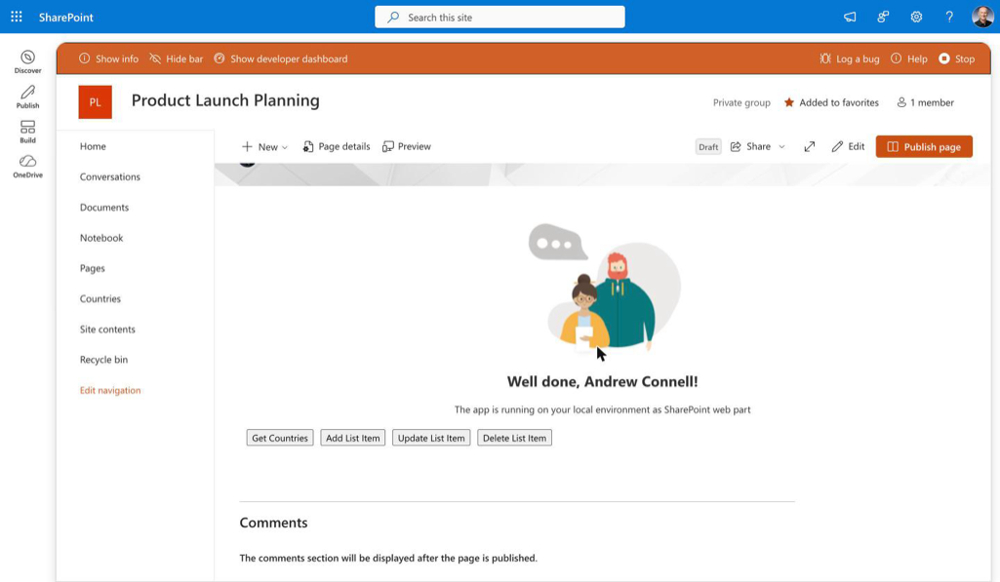

# SPFxHttpClientDemo

Reads, creates, updates, and deletes items in a SharePoint list.

This project is the completed solution for the exercise **Write operations using the SharePoint Framework APIs and SharePoint REST API** in the Microsoft Learn module [Work with SharePoint Content using the SharePoint Framework](https://learn.microsoft.com/training/modules/sharepoint-spfx-spcontent/). For compatibility, prerequisites, and help, see the [tutorial README](../README.md).

## Prerequisites

* A list named **Countries** in the site, with an item titled **United States**

## Checkpoints

The `checkpoints` folder contains the code as it was at the end of each earlier exercise:

* [Retrieve and display list data with the SharePoint REST API](checkpoints/3-exercise-get-data/README.md)

## Minimal path to awesome

* Clone this repository, or [download this tutorial as a .ZIP file](https://pnp.github.io/download-partial/?url=https://github.com/pnp/sp-dev-fx-webparts/tree/main/tutorials/mslearn-module-spcontent) and unzip it.
* From your command line, change to the `tutorials/mslearn-module-spcontent/SPFxHttpClientDemo` folder.
* Ensure that you're using a supported Node.js version. If you use nvm, run `nvm use`.
* In `config/serve.json`, replace the page URL (`initialPage`, or `pageUrl` for extensions) with a page in a site you can test on. Set the `SPFX_SERVE_TENANT_DOMAIN` environment variable to your SharePoint Online domain, for example `contoso.sharepoint.com`.
* In the command line, run:
  * `npm install`
  * `npm run start`
* To build a deployable package, run `npm run build`. The package is saved in the `sharepoint/solution` folder.
