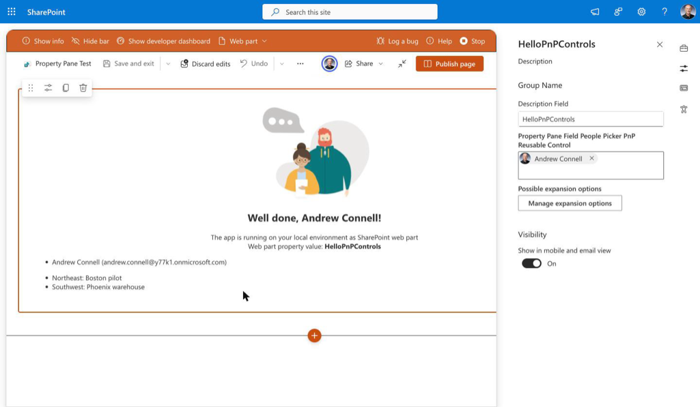

# HelloPnPControls

The PnP people picker and collection data property pane controls.

This project is the completed solution for the exercise **Use the SPFx PnP reusable property pane controls** in the Microsoft Learn module [Enable SharePoint Framework web part configuration with property panes](https://learn.microsoft.com/training/modules/sharepoint-spfx-web-part-property-pane/). For compatibility, prerequisites, and help, see the [tutorial README](../README.md).

## Minimal path to awesome

* Clone this repository, or [download this tutorial as a .ZIP file](https://pnp.github.io/download-partial/?url=https://github.com/pnp/sp-dev-fx-webparts/tree/main/tutorials/mslearn-module-web-part-property-pane) and unzip it.
* From your command line, change to the `tutorials/mslearn-module-web-part-property-pane/HelloPnPControls` folder.
* Ensure that you're using a supported Node.js version. If you use nvm, run `nvm use`.
* In `config/serve.json`, replace the page URL (`initialPage`, or `pageUrl` for extensions) with a page in a site you can test on. Set the `SPFX_SERVE_TENANT_DOMAIN` environment variable to your SharePoint Online domain, for example `contoso.sharepoint.com`.
* In the command line, run:
  * `npm install`
  * `npm run start`
* To build a deployable package, run `npm run build`. The package is saved in the `sharepoint/solution` folder.
